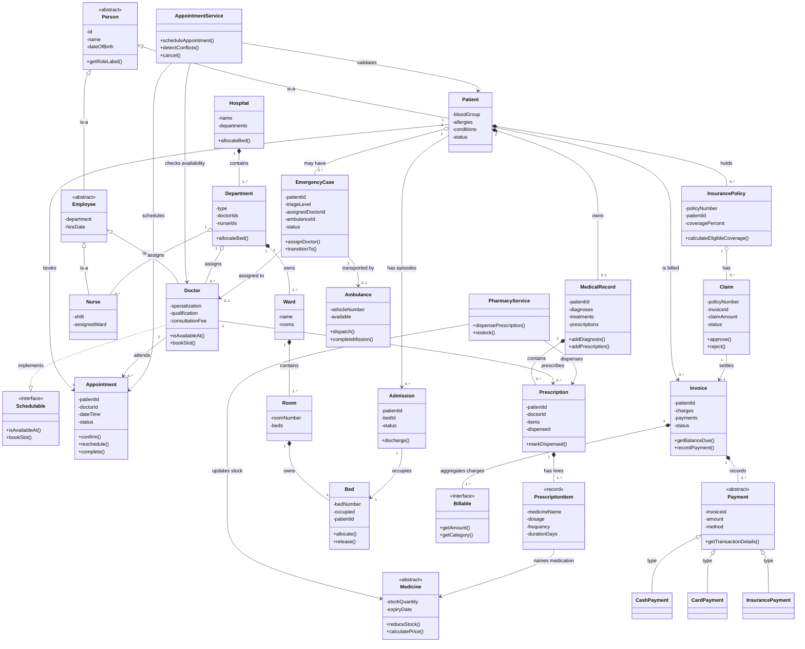

# NEXUS - Smart Hospital Management System

NEXUS is a console-based Java 17+ hospital management system with domain-driven design, role-based security, file persistence, notifications, analytics, and automated tests.

## Project at a Glance

| Area | Responsibility |
|---|---|
| Entry point | `Main` starts `ApplicationLauncher`. |
| Application layer | Coordinates patient, doctor, nurse, appointment, billing, pharmacy, emergency, insurance, report, and dashboard operations. |
| Domain layer | Stores business entities, lifecycle rules, state machines, events, and value objects. |
| Infrastructure layer | Provides file repositories, audit logging, and notification delivery. |
| Presentation layer | Displays menus, tables, dashboards, and validated console input. |
| Security | Provides authentication, authorization, roles, permissions, and password hashing. |
| Data storage | Uses text/TSV files under `data/`. |

## Short UML Overview



### UML Relationship Guide

- `<|--` = inheritance/is-a: `Patient`, `Doctor`, and `Nurse` extend the shared people hierarchy.
- `..|>` = interface realization: `Doctor` implements the `Schedulable` contract.
- `*--` = composition: the aggregate owns child objects, such as `MedicalRecord` -> `Prescription`.
- `o--` = aggregation: independently managed objects are associated, such as `Department` -> `Doctor`.
- `-->` = association or dependency: IDs connect domain records across repositories and services.
- Multiplicity on relationship lines shows expected cardinality, for example `Patient "1" --> "0..*" Appointment`.

## Quick Start

```bash
# Linux, Git Bash, or compatible shell
./build.sh run
./build.sh test
```

```powershell
# Windows PowerShell
New-Item -ItemType Directory -Force -Path out | Out-Null
$sources = Get-ChildItem -Recurse -Filter *.java -Path src | ForEach-Object { $_.FullName }
javac -d out $sources
java -cp out Main
```

The demo account is normally `admin / admin123`. Existing files in `data/` are preserved; demo seeding fills only empty collections.

## Ownership and Difficulty Sections

| Section | Owner | Scope |
|---|---|---|
| Hard | Rian | Core application and domain implementation |
| Medium | Imteaz | Presentation and infrastructure implementation |
| Easy | Puja | Security, patterns, utilities, and exceptions |
| Easy | Sajid | Entry point, tests, data, and project setup |


# Hard - Rian's Part

Core application use cases and domain model.

## Package and Class Reference

### `nexus.application.appointment`

| Class | Work and functions |
|---|---|
| [`AppointmentRequest`](src/nexus/application/appointment/AppointmentRequest.java) (`record`) | `AppointmentRequest(String patientId, String doctorId, LocalDateTime dateTime, String reason)` - Constructs and initializes the record. |
| [`AppointmentService`](src/nexus/application/appointment/AppointmentService.java) (`class`) | `AppointmentService(AppointmentRepository repository, DoctorRepository doctorRepository,
                              PatientService patientService, IdGenerator idGenerator,
                              EventBus eventBus, AuditLogger audit, SessionContext session)` - Constructs and initializes the class.; `scheduleAppointment(AppointmentRequest req)` - Schedules a new timed activity.; `reschedule(String appointmentId, LocalDateTime newTime)` - Moves an existing timed activity to a new time.; `cancel(String appointmentId, String reason)` - Cancels an active record and updates its state.; `confirm(String appointmentId)` - Moves a record into its confirmed state.; `start(String appointmentId)` - Starts or launches the component.; `complete(String appointmentId, String completionNotes)` - Marks work as completed and records completion details.; `markNoShow(String appointmentId)` - Performs the class-specific business or support operation.; `getAppointment(String id)` - Retrieves one value or object.; `listAppointments()` - Returns a collection of matching records.; `listByDoctor(String doctorId)` - Returns a collection of matching records.; `listByPatient(String patientId)` - Returns a collection of matching records.; `listByDate(LocalDate date)` - Returns a collection of matching records.; `detectConflicts(String doctorId, String patientId, LocalDateTime start, int duration, String ignoreId)` - Performs the class-specific business or support operation. |

### `nexus.application.billing`

| Class | Work and functions |
|---|---|
| [`BillingService`](src/nexus/application/billing/BillingService.java) (`class`) | `BillingService(InvoiceRepository repository, PatientService patientService,
                          IdGenerator invoiceIdGen, IdGenerator paymentIdGen,
                          EventBus eventBus, AuditLogger audit, SessionContext session)` - Constructs and initializes the class.; `createInvoice(String patientId, List<Billable> charges, double discountAmount, double taxAmount)` - Creates and stores a new domain object.; `addCharge(String invoiceId, Billable charge)` - Adds a value or child object to the current state.; `processPayment(String invoiceId, PaymentStrategy strategy, double amount)` - Executes the relevant business operation.; `getInvoice(String id)` - Retrieves one value or object.; `listInvoicesForPatient(String patientId)` - Returns a collection of matching records.; `listPendingInvoices()` - Returns a collection of matching records.; `listAll()` - Returns a collection of matching records.; `getTotalRevenue()` - Retrieves one value or object.; `getTotalOutstanding()` - Retrieves one value or object. |

### `nexus.application.bootstrap`

| Class | Work and functions |
|---|---|
| [`ApplicationBootstrap`](src/nexus/application/bootstrap/ApplicationBootstrap.java) (`class`) | `ApplicationBootstrap()` - Constructs and initializes the class.; `initialize(ApplicationConfig config)` - Creates and wires the required application dependencies.; `seedDefaultAdmin(UserRepository users, UserFactory factory)` - Adds demo data when the collection is empty. |
| [`ApplicationContext`](src/nexus/application/bootstrap/ApplicationContext.java) (`record`) | `shutdown()` - Stops background work and releases resources. |
| [`DemoDataSeeder`](src/nexus/application/bootstrap/DemoDataSeeder.java) (`class`) | `DemoDataSeeder()` - Constructs and initializes the class.; `createPatients()` - Creates and stores a new domain object.; `createDoctors()` - Creates and stores a new domain object.; `createNurses()` - Creates and stores a new domain object.; `createAppointments(PatientRepository patients, DoctorRepository doctors)` - Creates and stores a new domain object.; `createMedicines()` - Creates and stores a new domain object.; `createEmergencyCases(PatientRepository patients)` - Creates and stores a new domain object.; `createInvoices(PatientRepository patients, DoctorRepository doctors)` - Creates and stores a new domain object.; `id(String prefix, int sequence)` - Performs the class-specific business or support operation. |

### `nexus.application.config`

| Class | Work and functions |
|---|---|
| [`ApplicationConfig`](src/nexus/application/config/ApplicationConfig.java) (`record`) | `defaults()` - Performs the class-specific business or support operation. |

### `nexus.application.dashboard`

| Class | Work and functions |
|---|---|
| [`DashboardData`](src/nexus/application/dashboard/DashboardData.java) (`record`) | Stores or models record-specific behavior. |
| [`DashboardService`](src/nexus/application/dashboard/DashboardService.java) (`class`) | `DashboardService(PatientService patientService, DoctorService doctorService,
                            NurseService nurseService, HospitalService hospitalService,
                            AppointmentService appointmentService, PharmacyService pharmacyService,
                            EmergencyService emergencyService, BillingService billingService)` - Constructs and initializes the class.; `getDashboardForUser(User user)` - Retrieves one value or object. |

### `nexus.application.doctor`

| Class | Work and functions |
|---|---|
| [`DoctorRegistration`](src/nexus/application/doctor/DoctorRegistration.java) (`record`) | Stores or models record-specific behavior. |
| [`DoctorService`](src/nexus/application/doctor/DoctorService.java) (`class`) | `DoctorService(DoctorRepository repository, IdGenerator idGenerator, AuditLogger audit, SessionContext session)` - Constructs and initializes the class.; `registerDoctor(DoctorRegistration r)` - Registers a new record after validation.; `listDoctors()` - Returns a collection of matching records.; `searchBySpecialization(String fragment)` - Searches records using the supplied criteria.; `groupByDepartment()` - Performs the class-specific business or support operation. |
| [`DoctorSortOption`](src/nexus/application/doctor/DoctorSortOption.java) (`enum`) Constants: BY_NAME, BY_EXPERIENCE, BY_FEE_LOW, BY_FEE_HIGH. | `comparator()` - Performs the class-specific business or support operation. |

### `nexus.application.emergency`

| Class | Work and functions |
|---|---|
| [`EmergencyService`](src/nexus/application/emergency/EmergencyService.java) (`class`) | `EmergencyService(EmergencyRepository repository, IdGenerator idGenerator,
                            EventBus eventBus, AuditLogger audit, SessionContext session)` - Constructs and initializes the class.; `TriageQueue()` - Performs the class-specific business or support operation.; `registerCase(String patientName, String patientId, TriageLevel triageLevel,
                                      String chiefComplaint, String ambulanceId)` - Registers a new record after validation.; `attendNextCase(String doctorId)` - Performs the class-specific business or support operation.; `getCase(String id)` - Retrieves one value or object.; `updateStatus(String id, EmergencyStatus nextStatus, String notes)` - Updates an existing record.; `listTriageQueue()` - Returns a collection of matching records.; `listAllCases()` - Returns a collection of matching records.; `listAmbulances()` - Returns a collection of matching records.; `dispatchAmbulance(String ambulanceId, String destination)` - Sends or assigns work to the appropriate destination.; `releaseAmbulance(String ambulanceId)` - Performs the class-specific business or support operation.; `initFleet()` - Performs the class-specific business or support operation.; `initQueue()` - Performs the class-specific business or support operation. |

### `nexus.application.hospital`

| Class | Work and functions |
|---|---|
| [`HospitalService`](src/nexus/application/hospital/HospitalService.java) (`class`) | `HospitalService(Hospital hospital, DepartmentRepository departmentRepository,
                           AdmissionRepository admissionRepository, PatientService patientService,
                           IdGenerator admissionIdGenerator, AuditLogger audit, SessionContext session)` - Constructs and initializes the class.; `getHospital()` - Retrieves one value or object.; `listDepartments()` - Returns a collection of matching records.; `getDepartment(DepartmentType type)` - Retrieves one value or object.; `admitPatient(String patientId, DepartmentType departmentType, String reason)` - Creates or processes a hospital admission.; `dischargePatient(String patientId, String summary)` - Releases an admitted patient and closes the admission.; `getAdmissionsForPatient(String patientId)` - Retrieves one value or object.; `listActiveAdmissions()` - Returns a collection of matching records.; `initDefaultStructureIfEmpty()` - Performs the class-specific business or support operation. |

### `nexus.application.insurance`

| Class | Work and functions |
|---|---|
| [`InsuranceService`](src/nexus/application/insurance/InsuranceService.java) (`class`) | `InsuranceService(InsurancePolicyRepository policyRepository, ClaimRepository claimRepository,
                            PatientService patientService, IdGenerator claimIdGen,
                            AuditLogger audit, SessionContext session)` - Constructs and initializes the class.; `registerPolicy(InsurancePolicy policy)` - Registers a new record after validation.; `getPolicy(String policyNumber)` - Retrieves one value or object.; `getPolicyForPatient(String patientId)` - Retrieves one value or object.; `submitClaim(String policyNumber, String invoiceId, double claimAmount)` - Performs the class-specific business or support operation.; `reviewClaim(String claimId)` - Performs the class-specific business or support operation.; `approveClaim(String claimId, double approvedAmount)` - Performs the class-specific business or support operation.; `rejectClaim(String claimId, String reason)` - Performs the class-specific business or support operation.; `settleClaim(String claimId, BillingService billingService)` - Updates the object's corresponding field.; `getClaim(String id)` - Retrieves one value or object.; `listClaims()` - Returns a collection of matching records.; `listPolicies()` - Returns a collection of matching records. |

### `nexus.application.launcher`

| Class | Work and functions |
|---|---|
| [`ApplicationLauncher`](src/nexus/application/launcher/ApplicationLauncher.java) (`class`) | `ApplicationLauncher()` - Constructs and initializes the class.; `start()` - Starts or launches the component. |

### `nexus.application.medical`

| Class | Work and functions |
|---|---|
| [`MedicalRecordService`](src/nexus/application/medical/MedicalRecordService.java) (`class`) | `MedicalRecordService(MedicalRecordRepository recordRepository,
                                PrescriptionRepository prescriptionRepository,
                                PatientService patientService,
                                IdGenerator recordIdGen,
                                IdGenerator prescriptionIdGen,
                                AuditLogger audit,
                                SessionContext session)` - Constructs and initializes the class.; `getOrCreateRecord(String patientId)` - Retrieves one value or object.; `addDiagnosis(String patientId, String doctorId, String description, String severity)` - Adds a value or child object to the current state.; `addTreatment(String patientId, String description, String plan, int durationDays)` - Adds a value or child object to the current state.; `addTestResult(String patientId, String testName, String category,
                              String resultValue, String referenceRange, String remarks)` - Adds a value or child object to the current state.; `addDoctorNote(String patientId, String note)` - Adds a value or child object to the current state.; `issuePrescription(String patientId, String doctorId, List<PrescriptionItem> items, String notes)` - Returns a boolean state or eligibility result.; `listPrescriptions(String patientId)` - Returns a collection of matching records.; `getPrescription(String id)` - Retrieves one value or object.; `markDispensed(String prescriptionId)` - Performs the class-specific business or support operation. |

### `nexus.application.nurse`

| Class | Work and functions |
|---|---|
| [`NurseRegistration`](src/nexus/application/nurse/NurseRegistration.java) (`record`) | Stores or models record-specific behavior. |
| [`NurseService`](src/nexus/application/nurse/NurseService.java) (`class`) | `NurseService(NurseRepository repository, IdGenerator idGenerator, AuditLogger audit, SessionContext session)` - Constructs and initializes the class.; `registerNurse(NurseRegistration r)` - Registers a new record after validation.; `getNurse(String id)` - Retrieves one value or object.; `listNurses()` - Returns a collection of matching records.; `listByDepartment(DepartmentType department)` - Returns a collection of matching records.; `listByShift(Shift shift)` - Returns a collection of matching records.; `reassign(String id, Shift newShift, String newWard)` - Performs the class-specific business or support operation. |

### `nexus.application.patient`

| Class | Work and functions |
|---|---|
| [`PatientService`](src/nexus/application/patient/PatientService.java) (`class`) | `PatientService(PatientRepository repository, IdGenerator idGenerator, EventBus eventBus,
                          AuditLogger audit, SessionContext session)` - Constructs and initializes the class.; `registerPatient(Patient.Builder builder)` - Registers a new record after validation.; `getPatient(String id)` - Retrieves one value or object.; `searchByName(String fragment)` - Searches records using the supplied criteria.; `listPatients(PatientSortOption sortOption)` - Returns a collection of matching records.; `changeStatus(String id, PatientStatus next)` - Performs the class-specific business or support operation.; `countByStatus()` - Performs the class-specific business or support operation.; `rejectDuplicate(Patient candidate)` - Performs the class-specific business or support operation. |
| [`PatientSortOption`](src/nexus/application/patient/PatientSortOption.java) (`enum`) Constants: BY_ID, ID, BY_NAME, BY_AGE, BY_REGISTRATION. | `comparator()` - Performs the class-specific business or support operation. |

### `nexus.application.pharmacy`

| Class | Work and functions |
|---|---|
| [`MedicineSortOption`](src/nexus/application/pharmacy/MedicineSortOption.java) (`enum`) Constants: BY_NAME, BY_PRICE_LOW, BY_PRICE_HIGH, BY_STOCK, BY_EXPIRY. | `comparator()` - Performs the class-specific business or support operation. |
| [`PharmacyService`](src/nexus/application/pharmacy/PharmacyService.java) (`class`) | `PharmacyService(MedicineRepository repository, EventBus eventBus, AuditLogger audit, SessionContext session)` - Constructs and initializes the class.; `PharmacyService(MedicineRepository repository, EventBus eventBus, AuditLogger audit, SessionContext session, boolean startScheduler)` - Constructs and initializes the class.; `addMedicine(Medicine medicine)` - Adds a value or child object to the current state.; `getMedicine(String id)` - Retrieves one value or object.; `listAll()` - Returns a collection of matching records.; `search(String query)` - Searches records using the supplied criteria.; `listLowStock()` - Returns a collection of matching records.; `listExpiringSoon(int daysAhead)` - Returns a collection of matching records.; `restock(String medicineId, int quantity)` - Performs the class-specific business or support operation.; `dispense(String medicineId, int quantity)` - Performs the class-specific business or support operation.; `dispenseByPrescription(String prescriptionId, MedicalRecordService medicalRecordService)` - Performs the class-specific business or support operation.; `checkInventoryAlerts()` - Performs the class-specific business or support operation.; `shutdown()` - Stops background work and releases resources. |

### `nexus.application.report`

| Class | Work and functions |
|---|---|
| [`AppointmentAnalyticsReport`](src/nexus/application/report/AppointmentAnalyticsReport.java) (`class`) | `AppointmentAnalyticsReport(AppointmentService service)` - Constructs and initializes the class.; `generate()` - Builds a report or derived result. |
| [`DoctorWorkloadReport`](src/nexus/application/report/DoctorWorkloadReport.java) (`class`) | `DoctorWorkloadReport(DoctorService doctorService, AppointmentService appointmentService)` - Constructs and initializes the class.; `generate()` - Builds a report or derived result. |
| [`EmergencyTriageReport`](src/nexus/application/report/EmergencyTriageReport.java) (`class`) | `EmergencyTriageReport(EmergencyService service)` - Constructs and initializes the class.; `generate()` - Builds a report or derived result. |
| [`FinancialRevenueReport`](src/nexus/application/report/FinancialRevenueReport.java) (`class`) | `FinancialRevenueReport(BillingService service)` - Constructs and initializes the class.; `generate()` - Builds a report or derived result. |
| [`InsuranceClaimReport`](src/nexus/application/report/InsuranceClaimReport.java) (`class`) | `InsuranceClaimReport(InsuranceService service)` - Constructs and initializes the class.; `generate()` - Builds a report or derived result. |
| [`PatientDemographicsReport`](src/nexus/application/report/PatientDemographicsReport.java) (`class`) | `PatientDemographicsReport(PatientService patientService)` - Constructs and initializes the class.; `generate()` - Builds a report or derived result. |
| [`PharmacyInventoryReport`](src/nexus/application/report/PharmacyInventoryReport.java) (`class`) | `PharmacyInventoryReport(PharmacyService service)` - Constructs and initializes the class.; `generate()` - Builds a report or derived result. |
| [`Report`](src/nexus/application/report/Report.java) (`interface`) | Stores or models interface-specific behavior. |
| [`ReportService`](src/nexus/application/report/ReportService.java) (`class`) | `ReportService(List<Report> reports)` - Constructs and initializes the class.; `getAvailableReports()` - Retrieves one value or object.; `generateReport(Report report)` - Builds a report or derived result.; `generateReportAsync(Report report)` - Builds a report or derived result. |

### `nexus.application.user`

| Class | Work and functions |
|---|---|
| [`UserService`](src/nexus/application/user/UserService.java) (`class`) | `UserService(UserRepository repository, UserFactory factory, AuditLogger audit, SessionContext session)` - Constructs and initializes the class.; `createUser(String username, String rawPassword, Role role, String staffId)` - Creates and stores a new domain object.; `listUsers()` - Returns a collection of matching records.; `toggleStatus(String username)` - Performs the class-specific business or support operation.; `linkStaff(String username, String staffId)` - Performs the class-specific business or support operation. |

### `nexus.domain.appointment`

| Class | Work and functions |
|---|---|
| [`Appointment`](src/nexus/domain/appointment/Appointment.java) (`class`) | `Appointment(String id, String patientId, String doctorId, LocalDateTime dateTime,
                       int durationMinutes, AppointmentPriority priority, String reason)` - Constructs and initializes the class.; `Appointment(String id, String patientId, String doctorId, LocalDateTime dateTime,
                       int durationMinutes, AppointmentPriority priority, AppointmentStatus status,
                       String reason, String cancellationReason, String notes)` - Constructs and initializes the class.; `getPatientId()` - Retrieves one value or object.; `getDoctorId()` - Retrieves one value or object.; `getDateTime()` - Retrieves one value or object.; `getDurationMinutes()` - Retrieves one value or object.; `getPriority()` - Retrieves one value or object.; `getStatus()` - Retrieves one value or object.; `getReason()` - Retrieves one value or object.; `getCancellationReason()` - Retrieves one value or object.; `getNotes()` - Retrieves one value or object.; `transitionTo(AppointmentStatus next)` - Performs the class-specific business or support operation.; `confirm()` - Moves a record into its confirmed state.; `start()` - Starts or launches the component.; `complete(String completionNotes)` - Marks work as completed and records completion details.; `cancel(String reason)` - Cancels an active record and updates its state.; `markNoShow()` - Performs the class-specific business or support operation.; `reschedule(LocalDateTime newDateTime)` - Moves an existing timed activity to a new time.; `toString()` - Performs the class-specific business or support operation. |
| [`AppointmentCancelledEvent`](src/nexus/domain/appointment/AppointmentCancelledEvent.java) (`record`) | `AppointmentCancelledEvent(Appointment appointment, String reason)` - Constructs and initializes the record. |
| [`AppointmentCreatedEvent`](src/nexus/domain/appointment/AppointmentCreatedEvent.java) (`record`) | `AppointmentCreatedEvent(Appointment appointment)` - Constructs and initializes the record. |
| [`AppointmentPriority`](src/nexus/domain/appointment/AppointmentPriority.java) (`enum`) Constants: ROUTINE, URGENT, EMERGENCY. | Stores or models enum-specific behavior. |
| [`AppointmentStatus`](src/nexus/domain/appointment/AppointmentStatus.java) (`enum`) Constants: SCHEDULED, CONFIRMED, CANCELLED, NO_SHOW. | `allowedNext()` - Checks whether a value or transition is permitted.; `isActive()` - Returns a boolean state or eligibility result.; `canTransitionTo(AppointmentStatus target)` - Checks whether a state transition is allowed. |
| [`Schedulable`](src/nexus/domain/appointment/Schedulable.java) (`interface`) | Stores or models interface-specific behavior. |

### `nexus.domain.billing`

| Class | Work and functions |
|---|---|
| [`Billable`](src/nexus/domain/billing/Billable.java) (`interface`) | Stores or models interface-specific behavior. |
| [`Builder`](src/nexus/domain/billing/Invoice.java) (`class`) | `Builder()` - Constructs and initializes the class.; `Invoice(Builder b)` - Performs the class-specific business or support operation.; `getPatientId()` - Retrieves one value or object.; `getIssueDate()` - Retrieves one value or object.; `getCharges()` - Retrieves one value or object.; `getDiscountAmount()` - Retrieves one value or object.; `getTaxAmount()` - Retrieves one value or object.; `getPaidAmount()` - Retrieves one value or object.; `getStatus()` - Retrieves one value or object.; `getPayments()` - Retrieves one value or object.; `getSubtotal()` - Retrieves one value or object.; `getTotalAmount()` - Retrieves one value or object.; `getBalanceDue()` - Retrieves one value or object.; `isPaid()` - Returns a boolean state or eligibility result.; `addCharge(Billable charge)` - Adds a value or child object to the current state.; `recordPayment(Payment payment)` - Performs the class-specific business or support operation.; `updateStatus()` - Updates an existing record.; `builder()` - Returns a builder for assembling the object.; `now()` - Performs the class-specific business or support operation.; `id(String id)` - Performs the class-specific business or support operation.; `patientId(String patientId)` - Performs the class-specific business or support operation.; `issueDate(LocalDate issueDate)` - Returns a boolean state or eligibility result.; `charge(Billable charge)` - Performs the class-specific business or support operation.; `charges(List<Billable> charges)` - Performs the class-specific business or support operation.; `discount(double discount)` - Performs the class-specific business or support operation.; `tax(double tax)` - Performs the class-specific business or support operation.; `paid(double paid)` - Performs the class-specific business or support operation.; `status(InvoiceStatus status)` - Performs the class-specific business or support operation.; `payment(Payment p)` - Records or processes a payment.; `build()` - Builds and returns the assembled object. |
| [`Invoice`](src/nexus/domain/billing/Invoice.java) (`class`) | `Invoice(Builder b)` - Constructs and initializes the class.; `getPatientId()` - Retrieves one value or object.; `getIssueDate()` - Retrieves one value or object.; `getCharges()` - Retrieves one value or object.; `getDiscountAmount()` - Retrieves one value or object.; `getTaxAmount()` - Retrieves one value or object.; `getPaidAmount()` - Retrieves one value or object.; `getStatus()` - Retrieves one value or object.; `getPayments()` - Retrieves one value or object.; `getSubtotal()` - Retrieves one value or object.; `getTotalAmount()` - Retrieves one value or object.; `getBalanceDue()` - Retrieves one value or object.; `isPaid()` - Returns a boolean state or eligibility result.; `addCharge(Billable charge)` - Adds a value or child object to the current state.; `recordPayment(Payment payment)` - Performs the class-specific business or support operation.; `updateStatus()` - Updates an existing record.; `builder()` - Returns a builder for assembling the object.; `now()` - Performs the class-specific business or support operation.; `Builder()` - Returns a builder for assembling the object.; `id(String id)` - Performs the class-specific business or support operation.; `patientId(String patientId)` - Performs the class-specific business or support operation.; `issueDate(LocalDate issueDate)` - Returns a boolean state or eligibility result.; `charge(Billable charge)` - Performs the class-specific business or support operation.; `charges(List<Billable> charges)` - Performs the class-specific business or support operation.; `discount(double discount)` - Performs the class-specific business or support operation.; `tax(double tax)` - Performs the class-specific business or support operation.; `paid(double paid)` - Performs the class-specific business or support operation.; `status(InvoiceStatus status)` - Performs the class-specific business or support operation.; `payment(Payment p)` - Records or processes a payment.; `build()` - Builds and returns the assembled object. |
| [`InvoiceStatus`](src/nexus/domain/billing/InvoiceStatus.java) (`enum`) Constants: UNPAID, PAID, PARTIALLY_PAID, CANCELLED. | Stores or models enum-specific behavior. |
| [`PaymentCompletedEvent`](src/nexus/domain/billing/PaymentCompletedEvent.java) (`record`) | `PaymentCompletedEvent(Invoice invoice, Payment payment)` - Constructs and initializes the record. |

### `nexus.domain.billing.charges`

| Class | Work and functions |
|---|---|
| [`ConsultationCharge`](src/nexus/domain/billing/charges/ConsultationCharge.java) (`record`) | Stores or models record-specific behavior. |
| [`EmergencyCharge`](src/nexus/domain/billing/charges/EmergencyCharge.java) (`record`) | Stores or models record-specific behavior. |
| [`LaboratoryCharge`](src/nexus/domain/billing/charges/LaboratoryCharge.java) (`record`) | Stores or models record-specific behavior. |
| [`MedicineCharge`](src/nexus/domain/billing/charges/MedicineCharge.java) (`record`) | `MedicineCharge(String medicineId, String medicineName, int quantity, double unitPrice)` - Constructs and initializes the record. |
| [`RoomCharge`](src/nexus/domain/billing/charges/RoomCharge.java) (`record`) | Stores or models record-specific behavior. |
| [`SurgeryCharge`](src/nexus/domain/billing/charges/SurgeryCharge.java) (`record`) | Stores or models record-specific behavior. |

### `nexus.domain.billing.payment`

| Class | Work and functions |
|---|---|
| [`CardPayment`](src/nexus/domain/billing/payment/CardPayment.java) (`class`) | `CardPayment(String id, String invoiceId, double amount, String cardLastFour, String authCode)` - Constructs and initializes the class.; `CardPayment(String id, String invoiceId, double amount, Instant timestamp, String cardLastFour, String authCode)` - Constructs and initializes the class.; `getCardLastFour()` - Retrieves one value or object.; `getAuthCode()` - Retrieves one value or object.; `getTransactionDetails()` - Retrieves one value or object. |
| [`CashPayment`](src/nexus/domain/billing/payment/CashPayment.java) (`class`) | `CashPayment(String id, String invoiceId, double amount, double tenderedAmount)` - Constructs and initializes the class.; `CashPayment(String id, String invoiceId, double amount, Instant timestamp, double tenderedAmount, double changeGiven)` - Constructs and initializes the class.; `getTenderedAmount()` - Retrieves one value or object.; `getChangeGiven()` - Retrieves one value or object.; `getTransactionDetails()` - Retrieves one value or object. |
| [`InsurancePayment`](src/nexus/domain/billing/payment/InsurancePayment.java) (`class`) | `InsurancePayment(String id, String invoiceId, double amount, String policyNumber, String claimId)` - Constructs and initializes the class.; `InsurancePayment(String id, String invoiceId, double amount, Instant timestamp, String policyNumber, String claimId)` - Constructs and initializes the class.; `getPolicyNumber()` - Retrieves one value or object.; `getClaimId()` - Retrieves one value or object.; `getTransactionDetails()` - Retrieves one value or object. |
| [`MobileBankingPayment`](src/nexus/domain/billing/payment/MobileBankingPayment.java) (`class`) | `MobileBankingPayment(String id, String invoiceId, double amount, String provider, String mobileNumber, String transactionId)` - Constructs and initializes the class.; `MobileBankingPayment(String id, String invoiceId, double amount, Instant timestamp,
                                String provider, String mobileNumber, String transactionId)` - Constructs and initializes the class.; `getProvider()` - Retrieves one value or object.; `getMobileNumber()` - Retrieves one value or object.; `getTransactionId()` - Retrieves one value or object.; `getTransactionDetails()` - Retrieves one value or object. |
| [`Payment`](src/nexus/domain/billing/payment/Payment.java) (`class`) | `Payment(String id, String invoiceId, double amount, Instant timestamp, String method)` - Constructs and initializes the class.; `getInvoiceId()` - Retrieves one value or object.; `getAmount()` - Retrieves one value or object.; `getTimestamp()` - Retrieves one value or object.; `getMethod()` - Retrieves one value or object.; `getTransactionDetails()` - Retrieves one value or object.; `toString()` - Performs the class-specific business or support operation. |
| [`for`](src/nexus/domain/billing/payment/Payment.java) (`class`) | `Payment(String id, String invoiceId, double amount, Instant timestamp, String method)` - Records or processes a payment.; `getInvoiceId()` - Retrieves one value or object.; `getAmount()` - Retrieves one value or object.; `getTimestamp()` - Retrieves one value or object.; `getMethod()` - Retrieves one value or object.; `getTransactionDetails()` - Retrieves one value or object.; `toString()` - Performs the class-specific business or support operation. |
| [`PaymentFactory`](src/nexus/domain/billing/payment/PaymentFactory.java) (`class`) | `PaymentFactory()` - Constructs and initializes the class.; `cash(double tenderedAmount)` - Performs the class-specific business or support operation.; `card(String cardLastFour, String authCode)` - Performs the class-specific business or support operation.; `mobileBanking(String provider, String mobileNumber, String trxId)` - Performs the class-specific business or support operation.; `insurance(String policyNumber, String claimId)` - Performs the class-specific business or support operation. |
| [`PaymentStrategy`](src/nexus/domain/billing/payment/PaymentStrategy.java) (`interface`) | Stores or models interface-specific behavior. |

### `nexus.domain.common`

| Class | Work and functions |
|---|---|
| [`BloodGroup`](src/nexus/domain/common/BloodGroup.java) (`enum`) Constants: AB_POSITIVE, AB, AB_NEGATIVE. | Stores or models enum-specific behavior. |
| [`DepartmentType`](src/nexus/domain/common/DepartmentType.java) (`enum`) Constants: CARDIOLOGY, NEUROLOGY, ORTHOPEDICS, PEDIATRICS, DERMATOLOGY, GENERAL_MEDICINE, EMERGENCY, SURGERY. | Stores or models enum-specific behavior. |
| [`Gender`](src/nexus/domain/common/Gender.java) (`enum`) Constants: MALE, FEMALE, OTHER. | Stores or models enum-specific behavior. |
| [`Identifiable`](src/nexus/domain/common/Identifiable.java) (`interface`) | Stores or models interface-specific behavior. |

### `nexus.domain.emergency`

| Class | Work and functions |
|---|---|
| [`Ambulance`](src/nexus/domain/emergency/Ambulance.java) (`class`) | `Ambulance(String id, String vehicleNumber, String driverName, String paramedicName)` - Constructs and initializes the class.; `Ambulance(String id, String vehicleNumber, String driverName, String paramedicName,
                     boolean available, String currentLocation)` - Constructs and initializes the class.; `getVehicleNumber()` - Retrieves one value or object.; `getDriverName()` - Retrieves one value or object.; `getParamedicName()` - Retrieves one value or object.; `isAvailable()` - Returns a boolean state or eligibility result.; `getCurrentLocation()` - Retrieves one value or object.; `dispatch(String destination)` - Sends or assigns work to the appropriate destination.; `completeMission()` - Marks work as completed and records completion details.; `toString()` - Performs the class-specific business or support operation. |
| [`EmergencyCase`](src/nexus/domain/emergency/EmergencyCase.java) (`class`) | `EmergencyCase(String id, String patientName, String patientId, TriageLevel triageLevel,
                         String chiefComplaint, String ambulanceId)` - Constructs and initializes the class.; `EmergencyCase(String id, String patientName, String patientId, TriageLevel triageLevel,
                         EmergencyStatus status, String chiefComplaint, String assignedDoctorId,
                         String ambulanceId, Instant arrivalTime, String notes)` - Constructs and initializes the class.; `getPatientName()` - Retrieves one value or object.; `getPatientId()` - Retrieves one value or object.; `getTriageLevel()` - Retrieves one value or object.; `getStatus()` - Retrieves one value or object.; `getChiefComplaint()` - Retrieves one value or object.; `getAssignedDoctorId()` - Retrieves one value or object.; `getAmbulanceId()` - Retrieves one value or object.; `getArrivalTime()` - Retrieves one value or object.; `getNotes()` - Retrieves one value or object.; `transitionTo(EmergencyStatus next)` - Performs the class-specific business or support operation.; `assignDoctor(String doctorId)` - Performs the class-specific business or support operation.; `addNotes(String notes)` - Adds a value or child object to the current state.; `toString()` - Performs the class-specific business or support operation. |
| [`EmergencyCreatedEvent`](src/nexus/domain/emergency/EmergencyCreatedEvent.java) (`record`) | `EmergencyCreatedEvent(EmergencyCase emergencyCase)` - Constructs and initializes the record. |
| [`EmergencyStatus`](src/nexus/domain/emergency/EmergencyStatus.java) (`enum`) Constants: TRIAGED, ATTENDING. | `allowedNext()` - Checks whether a value or transition is permitted.; `isActive()` - Returns a boolean state or eligibility result.; `canTransitionTo(EmergencyStatus next)` - Checks whether a state transition is allowed. |
| [`TriageLevel`](src/nexus/domain/emergency/TriageLevel.java) (`enum`) Constants: CRITICAL, URGENT, MODERATE, LOW. | `getSeverityRank()` - Retrieves one value or object.; `getDescription()` - Retrieves one value or object. |
| [`TriageQueue`](src/nexus/domain/emergency/TriageQueue.java) (`class`) | `enqueue(EmergencyCase emergencyCase)` - Performs the class-specific business or support operation.; `pollNext()` - Performs the class-specific business or support operation.; `peekNext()` - Performs the class-specific business or support operation.; `size()` - Performs the class-specific business or support operation.; `isEmpty()` - Returns a boolean state or eligibility result.; `remove(String caseId)` - Removes a value or relationship.; `toList()` - Performs the class-specific business or support operation. |

### `nexus.domain.hospital`

| Class | Work and functions |
|---|---|
| [`Admission`](src/nexus/domain/hospital/Admission.java) (`class`) | `Admission(String id, String patientId, String bedId, DepartmentType department, String reason)` - Constructs and initializes the class.; `Admission(String id, String patientId, String bedId, DepartmentType department,
                     Instant admitTime, String reason, Instant dischargeTime,
                     String dischargeSummary, AdmissionStatus status)` - Constructs and initializes the class.; `getPatientId()` - Retrieves one value or object.; `getBedId()` - Retrieves one value or object.; `getDepartment()` - Retrieves one value or object.; `getAdmitTime()` - Retrieves one value or object.; `getReason()` - Retrieves one value or object.; `getDischargeTime()` - Retrieves one value or object.; `getDischargeSummary()` - Retrieves one value or object.; `getStatus()` - Retrieves one value or object.; `discharge(String summary)` - Releases an admitted patient and closes the admission.; `toString()` - Performs the class-specific business or support operation. |
| [`AdmissionStatus`](src/nexus/domain/hospital/AdmissionStatus.java) (`enum`) Constants: ADMITTED, DISCHARGED. | Stores or models enum-specific behavior. |
| [`Bed`](src/nexus/domain/hospital/Bed.java) (`class`) | `Bed(String id, String bedNumber, BedType type)` - Constructs and initializes the class.; `Bed(String id, String bedNumber, BedType type, boolean occupied, String patientId)` - Constructs and initializes the class.; `getBedNumber()` - Retrieves one value or object.; `getType()` - Retrieves one value or object.; `isOccupied()` - Returns a boolean state or eligibility result.; `getPatientId()` - Retrieves one value or object.; `allocate(String patientId)` - Performs the class-specific business or support operation.; `release()` - Performs the class-specific business or support operation.; `toString()` - Performs the class-specific business or support operation. |
| [`BedType`](src/nexus/domain/hospital/BedType.java) (`enum`) Constants: GENERAL, ICU, CCU, SEMI_PRIVATE, PRIVATE. | Stores or models enum-specific behavior. |
| [`Department`](src/nexus/domain/hospital/Department.java) (`class`) | `Department(String id, DepartmentType type, String name)` - Constructs and initializes the class.; `Department(String id, DepartmentType type, String name, String headDoctorId)` - Constructs and initializes the class.; `getType()` - Retrieves one value or object.; `getName()` - Retrieves one value or object.; `getHeadDoctorId()` - Retrieves one value or object.; `setHeadDoctorId(String headDoctorId)` - Updates the object's corresponding field.; `getWards()` - Retrieves one value or object.; `getDoctorIds()` - Retrieves one value or object.; `getNurseIds()` - Retrieves one value or object.; `addWard(Ward ward)` - Adds a value or child object to the current state.; `assignDoctor(String doctorId)` - Performs the class-specific business or support operation.; `removeDoctor(String doctorId)` - Removes a value or relationship.; `assignNurse(String nurseId)` - Performs the class-specific business or support operation.; `removeNurse(String nurseId)` - Removes a value or relationship.; `allocateBed(String patientId)` - Performs the class-specific business or support operation.; `findBed(String bedId)` - Searches for matching records.; `getTotalBeds()` - Retrieves one value or object.; `getOccupiedBeds()` - Retrieves one value or object.; `toString()` - Performs the class-specific business or support operation. |
| [`Hospital`](src/nexus/domain/hospital/Hospital.java) (`class`) | `Hospital(String id, String name)` - Constructs and initializes the class.; `Hospital(String id, String name, List<Department> initialDepartments)` - Constructs and initializes the class.; `getName()` - Retrieves one value or object.; `getDepartments()` - Retrieves one value or object.; `addDepartment(Department department)` - Adds a value or child object to the current state.; `findDepartment(DepartmentType type)` - Searches for matching records.; `findDepartmentById(String deptId)` - Searches for matching records.; `allocateBed(DepartmentType deptType, String patientId)` - Performs the class-specific business or support operation.; `findBed(String bedId)` - Searches for matching records.; `getTotalBeds()` - Retrieves one value or object.; `getOccupiedBeds()` - Retrieves one value or object.; `getOccupancyRate()` - Retrieves one value or object.; `toString()` - Performs the class-specific business or support operation. |
| [`Room`](src/nexus/domain/hospital/Room.java) (`class`) | `Room(String id, String roomNumber, RoomType type)` - Constructs and initializes the class.; `Room(String id, String roomNumber, RoomType type, List<Bed> initialBeds)` - Constructs and initializes the class.; `getRoomNumber()` - Retrieves one value or object.; `getType()` - Retrieves one value or object.; `getBeds()` - Retrieves one value or object.; `addBed(Bed bed)` - Adds a value or child object to the current state.; `findFirstAvailableBed()` - Searches for matching records.; `findBed(String bedId)` - Searches for matching records.; `getCapacity()` - Retrieves one value or object.; `getOccupiedCount()` - Retrieves one value or object.; `hasAvailableBed()` - Performs the class-specific business or support operation.; `toString()` - Performs the class-specific business or support operation. |
| [`RoomType`](src/nexus/domain/hospital/RoomType.java) (`enum`) Constants: GENERAL_WARD, ICU_ROOM, ICU, SEMI_PRIVATE, PRIVATE_SUITE. | Stores or models enum-specific behavior. |
| [`Ward`](src/nexus/domain/hospital/Ward.java) (`class`) | `Ward(String id, String name, DepartmentType department)` - Constructs and initializes the class.; `Ward(String id, String name, DepartmentType department, List<Room> initialRooms)` - Constructs and initializes the class.; `getName()` - Retrieves one value or object.; `getDepartment()` - Retrieves one value or object.; `getRooms()` - Retrieves one value or object.; `addRoom(Room room)` - Adds a value or child object to the current state.; `findAvailableBed()` - Searches for matching records.; `findBed(String bedId)` - Searches for matching records.; `getTotalBeds()` - Retrieves one value or object.; `getOccupiedBeds()` - Retrieves one value or object.; `toString()` - Performs the class-specific business or support operation. |

### `nexus.domain.insurance`

| Class | Work and functions |
|---|---|
| [`Claim`](src/nexus/domain/insurance/Claim.java) (`class`) | `Claim(String id, String policyNumber, String patientId, String invoiceId, double claimAmount)` - Constructs and initializes the class.; `Claim(String id, String policyNumber, String patientId, String invoiceId,
                 double claimAmount, double approvedAmount, ClaimStatus status, String notes)` - Constructs and initializes the class.; `getPolicyNumber()` - Retrieves one value or object.; `getPatientId()` - Retrieves one value or object.; `getInvoiceId()` - Retrieves one value or object.; `getClaimAmount()` - Retrieves one value or object.; `getApprovedAmount()` - Retrieves one value or object.; `getStatus()` - Retrieves one value or object.; `getNotes()` - Retrieves one value or object.; `transitionTo(ClaimStatus next)` - Performs the class-specific business or support operation.; `review()` - Performs the class-specific business or support operation.; `approve(double approvedAmount)` - Performs the class-specific business or support operation.; `reject(String reason)` - Performs the class-specific business or support operation.; `markPaid()` - Performs the class-specific business or support operation.; `toString()` - Performs the class-specific business or support operation. |
| [`ClaimStatus`](src/nexus/domain/insurance/ClaimStatus.java) (`enum`) Constants: SUBMITTED, UNDER_REVIEW, REJECTED. | `allowedNext()` - Checks whether a value or transition is permitted.; `canTransitionTo(ClaimStatus next)` - Checks whether a state transition is allowed. |
| [`InsurancePolicy`](src/nexus/domain/insurance/InsurancePolicy.java) (`class`) | `InsurancePolicy(String policyNumber, String providerName, String patientId,
                           double coveragePercent, double maxCoverage, LocalDate expiryDate)` - Constructs and initializes the class.; `InsurancePolicy(String policyNumber, String providerName, String patientId,
                           double coveragePercent, double maxCoverage, double usedAmount, LocalDate expiryDate)` - Constructs and initializes the class.; `getPolicyNumber()` - Retrieves one value or object.; `getProviderName()` - Retrieves one value or object.; `getPatientId()` - Retrieves one value or object.; `getCoveragePercent()` - Retrieves one value or object.; `getMaxCoverage()` - Retrieves one value or object.; `getUsedAmount()` - Retrieves one value or object.; `getExpiryDate()` - Retrieves one value or object.; `getRemainingCoverage()` - Retrieves one value or object.; `isExpired()` - Returns a boolean state or eligibility result.; `calculateEligibleCoverage(double claimAmount)` - Calculates a derived numeric value.; `deduct(double approvedAmount)` - Performs the class-specific business or support operation.; `toString()` - Performs the class-specific business or support operation. |
| [`InsuranceProvider`](src/nexus/domain/insurance/InsuranceProvider.java) (`record`) | Stores or models record-specific behavior. |

### `nexus.domain.medical`

| Class | Work and functions |
|---|---|
| [`Diagnosis`](src/nexus/domain/medical/Diagnosis.java) (`record`) | `Diagnosis(String description, String severity, String doctorId)` - Constructs and initializes the record. |
| [`Builder`](src/nexus/domain/medical/MedicalRecord.java) (`class`) | `Builder()` - Constructs and initializes the class.; `MedicalRecord(Builder b)` - Performs the class-specific business or support operation.; `getPatientId()` - Retrieves one value or object.; `getCreatedAt()` - Retrieves one value or object.; `getLastUpdated()` - Retrieves one value or object.; `getDiagnoses()` - Retrieves one value or object.; `getTreatments()` - Retrieves one value or object.; `getTestResults()` - Retrieves one value or object.; `getPrescriptions()` - Retrieves one value or object.; `getDoctorNotes()` - Retrieves one value or object.; `addDiagnosis(Diagnosis diagnosis)` - Adds a value or child object to the current state.; `addTreatment(Treatment treatment)` - Adds a value or child object to the current state.; `addTestResult(TestResult testResult)` - Adds a value or child object to the current state.; `addPrescription(Prescription prescription)` - Adds a value or child object to the current state.; `addDoctorNote(String note)` - Adds a value or child object to the current state.; `touch()` - Performs the class-specific business or support operation.; `builder()` - Returns a builder for assembling the object.; `id(String id)` - Performs the class-specific business or support operation.; `patientId(String patientId)` - Performs the class-specific business or support operation.; `createdAt(Instant createdAt)` - Creates and stores a new domain object.; `lastUpdated(Instant lastUpdated)` - Performs the class-specific business or support operation.; `diagnosis(Diagnosis d)` - Performs the class-specific business or support operation.; `treatment(Treatment t)` - Performs the class-specific business or support operation.; `testResult(TestResult tr)` - Performs the class-specific business or support operation.; `prescription(Prescription p)` - Performs the class-specific business or support operation.; `doctorNote(String note)` - Performs the class-specific business or support operation.; `build()` - Builds and returns the assembled object. |
| [`MedicalRecord`](src/nexus/domain/medical/MedicalRecord.java) (`class`) | `MedicalRecord(Builder b)` - Constructs and initializes the class.; `getPatientId()` - Retrieves one value or object.; `getCreatedAt()` - Retrieves one value or object.; `getLastUpdated()` - Retrieves one value or object.; `getDiagnoses()` - Retrieves one value or object.; `getTreatments()` - Retrieves one value or object.; `getTestResults()` - Retrieves one value or object.; `getPrescriptions()` - Retrieves one value or object.; `getDoctorNotes()` - Retrieves one value or object.; `addDiagnosis(Diagnosis diagnosis)` - Adds a value or child object to the current state.; `addTreatment(Treatment treatment)` - Adds a value or child object to the current state.; `addTestResult(TestResult testResult)` - Adds a value or child object to the current state.; `addPrescription(Prescription prescription)` - Adds a value or child object to the current state.; `addDoctorNote(String note)` - Adds a value or child object to the current state.; `touch()` - Performs the class-specific business or support operation.; `builder()` - Returns a builder for assembling the object.; `Builder()` - Returns a builder for assembling the object.; `id(String id)` - Performs the class-specific business or support operation.; `patientId(String patientId)` - Performs the class-specific business or support operation.; `createdAt(Instant createdAt)` - Creates and stores a new domain object.; `lastUpdated(Instant lastUpdated)` - Performs the class-specific business or support operation.; `diagnosis(Diagnosis d)` - Performs the class-specific business or support operation.; `treatment(Treatment t)` - Performs the class-specific business or support operation.; `testResult(TestResult tr)` - Performs the class-specific business or support operation.; `prescription(Prescription p)` - Performs the class-specific business or support operation.; `doctorNote(String note)` - Performs the class-specific business or support operation.; `build()` - Builds and returns the assembled object. |
| [`id`](src/nexus/domain/medical/MedicalRecord.java) (`record`) | `MedicalRecord(Builder b)` - Performs the class-specific business or support operation.; `getPatientId()` - Retrieves one value or object.; `getCreatedAt()` - Retrieves one value or object.; `getLastUpdated()` - Retrieves one value or object.; `getDiagnoses()` - Retrieves one value or object.; `getTreatments()` - Retrieves one value or object.; `getTestResults()` - Retrieves one value or object.; `getPrescriptions()` - Retrieves one value or object.; `getDoctorNotes()` - Retrieves one value or object.; `addDiagnosis(Diagnosis diagnosis)` - Adds a value or child object to the current state.; `addTreatment(Treatment treatment)` - Adds a value or child object to the current state.; `addTestResult(TestResult testResult)` - Adds a value or child object to the current state.; `addPrescription(Prescription prescription)` - Adds a value or child object to the current state.; `addDoctorNote(String note)` - Adds a value or child object to the current state.; `touch()` - Performs the class-specific business or support operation.; `builder()` - Returns a builder for assembling the object.; `Builder()` - Returns a builder for assembling the object.; `patientId(String patientId)` - Performs the class-specific business or support operation.; `createdAt(Instant createdAt)` - Creates and stores a new domain object.; `lastUpdated(Instant lastUpdated)` - Performs the class-specific business or support operation.; `diagnosis(Diagnosis d)` - Performs the class-specific business or support operation.; `treatment(Treatment t)` - Performs the class-specific business or support operation.; `testResult(TestResult tr)` - Performs the class-specific business or support operation.; `prescription(Prescription p)` - Performs the class-specific business or support operation.; `doctorNote(String note)` - Performs the class-specific business or support operation.; `build()` - Builds and returns the assembled object. |
| [`Prescription`](src/nexus/domain/medical/Prescription.java) (`class`) | `Prescription(String id, String patientId, String doctorId, List<PrescriptionItem> items, String notes)` - Constructs and initializes the class.; `Prescription(String id, String patientId, String doctorId, LocalDate issueDate,
                        List<PrescriptionItem> items, String notes, boolean dispensed)` - Constructs and initializes the class.; `getPatientId()` - Retrieves one value or object.; `getDoctorId()` - Retrieves one value or object.; `getIssueDate()` - Retrieves one value or object.; `getItems()` - Retrieves one value or object.; `getNotes()` - Retrieves one value or object.; `isDispensed()` - Returns a boolean state or eligibility result.; `markDispensed()` - Performs the class-specific business or support operation.; `addItem(PrescriptionItem item)` - Adds a value or child object to the current state.; `toString()` - Performs the class-specific business or support operation. |
| [`PrescriptionItem`](src/nexus/domain/medical/PrescriptionItem.java) (`record`) | `toString()` - Performs the class-specific business or support operation. |
| [`TestResult`](src/nexus/domain/medical/TestResult.java) (`record`) | `TestResult(String testName, String category, String resultValue, String referenceRange, String remarks)` - Constructs and initializes the record. |
| [`Treatment`](src/nexus/domain/medical/Treatment.java) (`record`) | `Treatment(String description, String plan, int durationDays)` - Constructs and initializes the record. |

### `nexus.domain.people`

| Class | Work and functions |
|---|---|
| [`Person`](src/nexus/domain/people/Person.java) (`class`) | `Person(String id, String name, LocalDate dateOfBirth, Gender gender, String phone, String email)` - Constructs and initializes the class.; `getName()` - Retrieves one value or object.; `getDateOfBirth()` - Retrieves one value or object.; `getGender()` - Retrieves one value or object.; `getPhone()` - Retrieves one value or object.; `getEmail()` - Retrieves one value or object.; `getAge()` - Retrieves one value or object.; `setName(String name)` - Updates the object's corresponding field.; `setPhone(String phone)` - Updates the object's corresponding field.; `setEmail(String email)` - Updates the object's corresponding field.; `getRoleLabel()` - Retrieves one value or object. |

### `nexus.domain.people.admin`

| Class | Work and functions |
|---|---|
| [`Administrator`](src/nexus/domain/people/admin/Administrator.java) (`class`) | `Administrator(String id, String name, LocalDate dob, Gender gender, String phone, String email,
                         DepartmentType department, LocalDate hireDate, String adminLevel)` - Constructs and initializes the class.; `getAdminLevel()` - Retrieves one value or object. |

### `nexus.domain.people.doctor`

| Class | Work and functions |
|---|---|
| [`Doctor`](src/nexus/domain/people/doctor/Doctor.java) (`class`) | `Doctor(String id, String name, LocalDate dob, Gender gender, String phone, String email,
                  DepartmentType department, LocalDate hireDate, String specialization,
                  String qualification, int experienceYears)` - Constructs and initializes the class.; `Doctor(String id, String name, LocalDate dob, Gender gender, String phone, String email,
                  DepartmentType department, LocalDate hireDate, String specialization,
                  String qualification, int experienceYears, double consultationFee)` - Constructs and initializes the class.; `getSpecialization()` - Retrieves one value or object.; `getQualification()` - Retrieves one value or object.; `getExperienceYears()` - Retrieves one value or object.; `getConsultationFee()` - Retrieves one value or object.; `setConsultationFee(double fee)` - Updates the object's corresponding field.; `isAvailableAt(LocalDateTime dateTime, int durationMinutes)` - Returns a boolean state or eligibility result.; `bookSlot(LocalDateTime dateTime, int durationMinutes)` - Performs the class-specific business or support operation.; `releaseSlot(LocalDateTime dateTime)` - Performs the class-specific business or support operation. |

### `nexus.domain.people.employee`

| Class | Work and functions |
|---|---|
| [`Employee`](src/nexus/domain/people/employee/Employee.java) (`class`) | `Employee(String id, String name, LocalDate dob, Gender gender, String phone, String email,
                       DepartmentType department, LocalDate hireDate)` - Constructs and initializes the class.; `getDepartment()` - Retrieves one value or object.; `getHireDate()` - Retrieves one value or object. |

### `nexus.domain.people.nurse`

| Class | Work and functions |
|---|---|
| [`Nurse`](src/nexus/domain/people/nurse/Nurse.java) (`class`) | `Nurse(String id, String name, LocalDate dob, Gender gender, String phone, String email,
                 DepartmentType department, LocalDate hireDate, Shift shift, String assignedWard)` - Constructs and initializes the class.; `getShift()` - Retrieves one value or object.; `getAssignedWard()` - Retrieves one value or object.; `reassign(Shift shift, String ward)` - Performs the class-specific business or support operation. |
| [`Shift`](src/nexus/domain/people/nurse/Shift.java) (`enum`) Constants: MORNING, EVENING, NIGHT. | Stores or models enum-specific behavior. |

### `nexus.domain.people.patient`

| Class | Work and functions |
|---|---|
| [`EmergencyContact`](src/nexus/domain/people/patient/EmergencyContact.java) (`record`) | Stores or models record-specific behavior. |
| [`Builder`](src/nexus/domain/people/patient/Patient.java) (`class`) | `Builder()` - Constructs and initializes the class.; `Patient(Builder b)` - Performs the class-specific business or support operation.; `getBloodGroup()` - Retrieves one value or object.; `getEmergencyContact()` - Retrieves one value or object.; `getAllergies()` - Retrieves one value or object.; `getConditions()` - Retrieves one value or object.; `getRegisteredAt()` - Retrieves one value or object.; `getStatus()` - Retrieves one value or object.; `transitionTo(PatientStatus next)` - Performs the class-specific business or support operation.; `builder()` - Returns a builder for assembling the object.; `now()` - Performs the class-specific business or support operation.; `id(String v)` - Performs the class-specific business or support operation.; `name(String v)` - Performs the class-specific business or support operation.; `dateOfBirth(LocalDate v)` - Performs the class-specific business or support operation.; `gender(Gender v)` - Performs the class-specific business or support operation.; `phone(String v)` - Performs the class-specific business or support operation.; `email(String v)` - Performs the class-specific business or support operation.; `bloodGroup(BloodGroup v)` - Performs the class-specific business or support operation.; `emergencyContact(EmergencyContact v)` - Performs the class-specific business or support operation.; `allergies(List<String> v)` - Performs the class-specific business or support operation.; `conditions(List<String> v)` - Performs the class-specific business or support operation.; `registeredAt(Instant v)` - Registers a new record after validation.; `status(PatientStatus v)` - Performs the class-specific business or support operation.; `build()` - Builds and returns the assembled object. |
| [`Patient`](src/nexus/domain/people/patient/Patient.java) (`class`) | `Patient(Builder b)` - Constructs and initializes the class.; `getBloodGroup()` - Retrieves one value or object.; `getEmergencyContact()` - Retrieves one value or object.; `getAllergies()` - Retrieves one value or object.; `getConditions()` - Retrieves one value or object.; `getRegisteredAt()` - Retrieves one value or object.; `getStatus()` - Retrieves one value or object.; `transitionTo(PatientStatus next)` - Performs the class-specific business or support operation.; `builder()` - Returns a builder for assembling the object.; `now()` - Performs the class-specific business or support operation.; `Builder()` - Returns a builder for assembling the object.; `id(String v)` - Performs the class-specific business or support operation.; `name(String v)` - Performs the class-specific business or support operation.; `dateOfBirth(LocalDate v)` - Performs the class-specific business or support operation.; `gender(Gender v)` - Performs the class-specific business or support operation.; `phone(String v)` - Performs the class-specific business or support operation.; `email(String v)` - Performs the class-specific business or support operation.; `bloodGroup(BloodGroup v)` - Performs the class-specific business or support operation.; `emergencyContact(EmergencyContact v)` - Performs the class-specific business or support operation.; `allergies(List<String> v)` - Performs the class-specific business or support operation.; `conditions(List<String> v)` - Performs the class-specific business or support operation.; `registeredAt(Instant v)` - Registers a new record after validation.; `status(PatientStatus v)` - Performs the class-specific business or support operation.; `build()` - Builds and returns the assembled object. |
| [`PatientRegisteredEvent`](src/nexus/domain/people/patient/PatientRegisteredEvent.java) (`record`) | `PatientRegisteredEvent(Patient patient)` - Constructs and initializes the record. |
| [`PatientStatus`](src/nexus/domain/people/patient/PatientStatus.java) (`enum`) Constants: REGISTERED, ADMITTED, DISCHARGED. | `allowedNext()` - Checks whether a value or transition is permitted.; `canTransitionTo(PatientStatus next)` - Checks whether a state transition is allowed. |

### `nexus.domain.people.pharmacist`

| Class | Work and functions |
|---|---|
| [`Pharmacist`](src/nexus/domain/people/pharmacist/Pharmacist.java) (`class`) | `Pharmacist(String id, String name, LocalDate dob, Gender gender, String phone, String email,
                      DepartmentType department, LocalDate hireDate, String licenseNumber)` - Constructs and initializes the class.; `getLicenseNumber()` - Retrieves one value or object. |

### `nexus.domain.people.receptionist`

| Class | Work and functions |
|---|---|
| [`Receptionist`](src/nexus/domain/people/receptionist/Receptionist.java) (`class`) | `Receptionist(String id, String name, LocalDate dob, Gender gender, String phone, String email,
                        DepartmentType department, LocalDate hireDate, String deskNumber)` - Constructs and initializes the class.; `getDeskNumber()` - Retrieves one value or object. |

### `nexus.domain.pharmacy`

| Class | Work and functions |
|---|---|
| [`Capsule`](src/nexus/domain/pharmacy/Capsule.java) (`class`) | `Capsule(String id, String name, String genericName, String supplier,
                   String batchNumber, LocalDate expiryDate, double unitPrice,
                   int stockQuantity, int minimumStock, int capsulesPerBox)` - Constructs and initializes the class.; `getCapsulesPerBox()` - Retrieves one value or object.; `calculatePrice(int quantity)` - Calculates a derived numeric value. |
| [`Injection`](src/nexus/domain/pharmacy/Injection.java) (`class`) | `Injection(String id, String name, String genericName, String supplier,
                     String batchNumber, LocalDate expiryDate, double unitPrice,
                     int stockQuantity, int minimumStock, int dosageMg, boolean requiresRefrigeration)` - Constructs and initializes the class.; `getDosageMg()` - Retrieves one value or object.; `requiresRefrigeration()` - Performs the class-specific business or support operation.; `calculatePrice(int quantity)` - Calculates a derived numeric value. |
| [`Medicine`](src/nexus/domain/pharmacy/Medicine.java) (`class`) | `Medicine(String id, String name, String genericName, String supplier,
                       String batchNumber, LocalDate expiryDate, double unitPrice,
                       int stockQuantity, int minimumStock)` - Constructs and initializes the class.; `getName()` - Retrieves one value or object.; `getGenericName()` - Retrieves one value or object.; `getSupplier()` - Retrieves one value or object.; `getBatchNumber()` - Retrieves one value or object.; `getExpiryDate()` - Retrieves one value or object.; `getUnitPrice()` - Retrieves one value or object.; `getStockQuantity()` - Retrieves one value or object.; `getMinimumStock()` - Retrieves one value or object.; `setUnitPrice(double unitPrice)` - Updates the object's corresponding field.; `restock(int quantity)` - Performs the class-specific business or support operation.; `reduceStock(int quantity)` - Performs the class-specific business or support operation.; `isLowStock()` - Returns a boolean state or eligibility result.; `isExpired()` - Returns a boolean state or eligibility result.; `calculatePrice(int quantity)` - Calculates a derived numeric value.; `getDosageForm()` - Retrieves one value or object.; `getAdministrationRoute()` - Retrieves one value or object. |
| [`for`](src/nexus/domain/pharmacy/Medicine.java) (`class`) | `Medicine(String id, String name, String genericName, String supplier,
                       String batchNumber, LocalDate expiryDate, double unitPrice,
                       int stockQuantity, int minimumStock)` - Performs the class-specific business or support operation.; `getName()` - Retrieves one value or object.; `getGenericName()` - Retrieves one value or object.; `getSupplier()` - Retrieves one value or object.; `getBatchNumber()` - Retrieves one value or object.; `getExpiryDate()` - Retrieves one value or object.; `getUnitPrice()` - Retrieves one value or object.; `getStockQuantity()` - Retrieves one value or object.; `getMinimumStock()` - Retrieves one value or object.; `setUnitPrice(double unitPrice)` - Updates the object's corresponding field.; `restock(int quantity)` - Performs the class-specific business or support operation.; `reduceStock(int quantity)` - Performs the class-specific business or support operation.; `isLowStock()` - Returns a boolean state or eligibility result.; `isExpired()` - Returns a boolean state or eligibility result.; `calculatePrice(int quantity)` - Calculates a derived numeric value.; `getDosageForm()` - Retrieves one value or object.; `getAdministrationRoute()` - Retrieves one value or object. |
| [`MedicineLowStockEvent`](src/nexus/domain/pharmacy/MedicineLowStockEvent.java) (`record`) | `MedicineLowStockEvent(Medicine medicine)` - Constructs and initializes the record. |
| [`Ointment`](src/nexus/domain/pharmacy/Ointment.java) (`class`) | `Ointment(String id, String name, String genericName, String supplier,
                    String batchNumber, LocalDate expiryDate, double unitPrice,
                    int stockQuantity, int minimumStock, int tubeWeightGrams)` - Constructs and initializes the class.; `getTubeWeightGrams()` - Retrieves one value or object.; `calculatePrice(int quantity)` - Calculates a derived numeric value. |
| [`Syrup`](src/nexus/domain/pharmacy/Syrup.java) (`class`) | `Syrup(String id, String name, String genericName, String supplier,
                 String batchNumber, LocalDate expiryDate, double unitPrice,
                 int stockQuantity, int minimumStock, int bottleVolumeMl)` - Constructs and initializes the class.; `getBottleVolumeMl()` - Retrieves one value or object.; `calculatePrice(int quantity)` - Calculates a derived numeric value. |
| [`Tablet`](src/nexus/domain/pharmacy/Tablet.java) (`class`) | `Tablet(String id, String name, String genericName, String supplier,
                  String batchNumber, LocalDate expiryDate, double unitPrice,
                  int stockQuantity, int minimumStock, int tabletsPerStrip)` - Constructs and initializes the class.; `getTabletsPerStrip()` - Retrieves one value or object.; `calculatePrice(int quantity)` - Calculates a derived numeric value. |


# Medium - Imteaz's Part

Console presentation and infrastructure integrations.

## Package and Class Reference

### `nexus.infrastructure.logging`

| Class | Work and functions |
|---|---|
| [`AsyncFileAuditLogger`](src/nexus/infrastructure/logging/AsyncFileAuditLogger.java) (`class`) | `AsyncFileAuditLogger(Path file)` - Constructs and initializes the class.; `newSingleThreadExecutor(r -> {
        Thread t = new Thread(r, "audit-writer")` - Performs the class-specific business or support operation.; `log(AuditEntry entry)` - Performs the class-specific business or support operation.; `close()` - Performs the class-specific business or support operation. |
| [`AuditAction`](src/nexus/infrastructure/logging/AuditAction.java) (`enum`) Constants: USER_LOGIN, USER_LOGOUT, PATIENT_REGISTERED, PATIENT_STATUS_CHANGED, DOCTOR_REGISTERED, APPOINTMENT_CREATED, APPOINTMENT_CANCELLED, MEDICINE_DISPENSED, PAYMENT_COMPLETED, EMERGENCY_CREATED, PATIENT_DISCHARGED. | Stores or models enum-specific behavior. |
| [`AuditEntry`](src/nexus/infrastructure/logging/AuditEntry.java) (`record`) | `of(String user, AuditAction action, String entity, String entityId, String status)` - Performs the class-specific business or support operation.; `toLine()` - Performs the class-specific business or support operation. |
| [`AuditLogger`](src/nexus/infrastructure/logging/AuditLogger.java) (`interface`) | Stores or models interface-specific behavior. |

### `nexus.infrastructure.notification`

| Class | Work and functions |
|---|---|
| [`ConsoleNotifier`](src/nexus/infrastructure/notification/ConsoleNotifier.java) (`class`) | `ConsoleNotifier(PrintStream out)` - Constructs and initializes the class.; `send(Notification n)` - Sends a notification through the configured channel. |
| [`EmailNotifier`](src/nexus/infrastructure/notification/EmailNotifier.java) (`class`) | `EmailNotifier()` - Constructs and initializes the class.; `EmailNotifier(PrintStream out)` - Constructs and initializes the class.; `send(Notification notification)` - Sends a notification through the configured channel. |
| [`Notification`](src/nexus/infrastructure/notification/Notification.java) (`record`) | Stores or models record-specific behavior. |
| [`NotificationService`](src/nexus/infrastructure/notification/NotificationService.java) (`class`) | `NotificationService(List<Notifier> notifiers)` - Constructs and initializes the class.; `onEvent(PatientRegisteredEvent event)` - Performs the class-specific business or support operation.; `onAppointmentCreated(AppointmentCreatedEvent event)` - Performs the class-specific business or support operation.; `onAppointmentCancelled(AppointmentCancelledEvent event)` - Performs the class-specific business or support operation.; `dispatch(Notification notification)` - Sends or assigns work to the appropriate destination. |
| [`Notifier`](src/nexus/infrastructure/notification/Notifier.java) (`interface`) | Stores or models interface-specific behavior. |
| [`NotifierFactory`](src/nexus/infrastructure/notification/NotifierFactory.java) (`class`) | `NotifierFactory()` - Constructs and initializes the class.; `createConsoleNotifier(PrintStream out)` - Creates and stores a new domain object.; `createEmailNotifier(PrintStream out)` - Creates and stores a new domain object.; `createSmsNotifier(PrintStream out)` - Creates and stores a new domain object.; `createDefaultNotifiers(PrintStream out)` - Creates and stores a new domain object. |
| [`SmsNotifier`](src/nexus/infrastructure/notification/SmsNotifier.java) (`class`) | `SmsNotifier()` - Constructs and initializes the class.; `SmsNotifier(PrintStream out)` - Constructs and initializes the class.; `send(Notification notification)` - Sends a notification through the configured channel. |

### `nexus.infrastructure.persistence.file`

| Class | Work and functions |
|---|---|
| [`FileAdmissionRepository`](src/nexus/infrastructure/persistence/file/FileAdmissionRepository.java) (`class`) | `FileAdmissionRepository(Path file)` - Constructs and initializes the class.; `findByPatientId(String patientId)` - Searches for matching records.; `findActiveByPatientId(String patientId)` - Searches for matching records.; `findActiveByBedId(String bedId)` - Searches for matching records.; `serialize(Admission a)` - Performs the class-specific business or support operation.; `deserialize(String[] f)` - Performs the class-specific business or support operation. |
| [`FileAppointmentRepository`](src/nexus/infrastructure/persistence/file/FileAppointmentRepository.java) (`class`) | `FileAppointmentRepository(Path file)` - Constructs and initializes the class.; `findByDoctorId(String doctorId)` - Searches for matching records.; `findByPatientId(String patientId)` - Searches for matching records.; `findByDate(LocalDate date)` - Searches for matching records.; `serialize(Appointment a)` - Performs the class-specific business or support operation.; `deserialize(String[] f)` - Performs the class-specific business or support operation. |
| [`FileClaimRepository`](src/nexus/infrastructure/persistence/file/FileClaimRepository.java) (`class`) | `FileClaimRepository(Path file)` - Constructs and initializes the class.; `findByPatientId(String patientId)` - Searches for matching records.; `findByPolicyNumber(String policyNumber)` - Searches for matching records.; `findByStatus(ClaimStatus status)` - Searches for matching records.; `serialize(Claim c)` - Performs the class-specific business or support operation.; `deserialize(String[] f)` - Performs the class-specific business or support operation. |
| [`FileDepartmentRepository`](src/nexus/infrastructure/persistence/file/FileDepartmentRepository.java) (`class`) | `FileDepartmentRepository(Path file)` - Constructs and initializes the class.; `findByType(DepartmentType type)` - Searches for matching records.; `serialize(Department d)` - Performs the class-specific business or support operation.; `deserialize(String[] f)` - Performs the class-specific business or support operation.; `encodeWards(List<Ward> wards)` - Performs the class-specific business or support operation.; `decodeWards(String str, DepartmentType deptType)` - Performs the class-specific business or support operation. |
| [`FileDoctorRepository`](src/nexus/infrastructure/persistence/file/FileDoctorRepository.java) (`class`) | `FileDoctorRepository(Path file)` - Constructs and initializes the class.; `findBySpecialization(String fragment)` - Searches for matching records.; `serialize(Doctor d)` - Performs the class-specific business or support operation.; `deserialize(String[] f)` - Performs the class-specific business or support operation. |
| [`FileEmergencyRepository`](src/nexus/infrastructure/persistence/file/FileEmergencyRepository.java) (`class`) | `FileEmergencyRepository(Path file)` - Constructs and initializes the class.; `findActiveCases()` - Searches for matching records.; `findByTriageLevel(TriageLevel level)` - Searches for matching records.; `serialize(EmergencyCase c)` - Performs the class-specific business or support operation.; `deserialize(String[] f)` - Performs the class-specific business or support operation. |
| [`FileInsurancePolicyRepository`](src/nexus/infrastructure/persistence/file/FileInsurancePolicyRepository.java) (`class`) | `FileInsurancePolicyRepository(Path file)` - Constructs and initializes the class.; `findByPatientId(String patientId)` - Searches for matching records.; `findByProvider(String providerName)` - Searches for matching records.; `serialize(InsurancePolicy p)` - Performs the class-specific business or support operation.; `deserialize(String[] f)` - Performs the class-specific business or support operation. |
| [`FileInvoiceRepository`](src/nexus/infrastructure/persistence/file/FileInvoiceRepository.java) (`class`) | `FileInvoiceRepository(Path file)` - Constructs and initializes the class.; `findByPatientId(String patientId)` - Searches for matching records.; `findPendingInvoices()` - Searches for matching records.; `serialize(Invoice inv)` - Performs the class-specific business or support operation.; `deserialize(String[] f)` - Performs the class-specific business or support operation. |
| [`SimpleCharge`](src/nexus/infrastructure/persistence/file/FileInvoiceRepository.java) (`record`) | `FileInvoiceRepository(Path file)` - Performs the class-specific business or support operation.; `findByPatientId(String patientId)` - Searches for matching records.; `findPendingInvoices()` - Searches for matching records.; `serialize(Invoice inv)` - Performs the class-specific business or support operation.; `deserialize(String[] f)` - Performs the class-specific business or support operation. |
| [`FileMedicalRecordRepository`](src/nexus/infrastructure/persistence/file/FileMedicalRecordRepository.java) (`class`) | `FileMedicalRecordRepository(Path file)` - Constructs and initializes the class.; `findByPatientId(String patientId)` - Searches for matching records.; `serialize(MedicalRecord r)` - Performs the class-specific business or support operation.; `deserialize(String[] f)` - Performs the class-specific business or support operation. |
| [`FileMedicineRepository`](src/nexus/infrastructure/persistence/file/FileMedicineRepository.java) (`class`) | `FileMedicineRepository(Path file)` - Constructs and initializes the class.; `findByNameContaining(String fragment)` - Searches for matching records.; `findLowStock()` - Searches for matching records.; `findExpiringBefore(LocalDate date)` - Searches for matching records.; `serialize(Medicine m)` - Performs the class-specific business or support operation.; `deserialize(String[] f)` - Performs the class-specific business or support operation. |
| [`FileNurseRepository`](src/nexus/infrastructure/persistence/file/FileNurseRepository.java) (`class`) | `FileNurseRepository(Path file)` - Constructs and initializes the class.; `findByDepartment(DepartmentType department)` - Searches for matching records.; `findByShift(Shift shift)` - Searches for matching records.; `serialize(Nurse n)` - Performs the class-specific business or support operation.; `deserialize(String[] f)` - Performs the class-specific business or support operation. |
| [`FilePatientRepository`](src/nexus/infrastructure/persistence/file/FilePatientRepository.java) (`class`) | `FilePatientRepository(Path file)` - Constructs and initializes the class.; `findByNameContaining(String fragment)` - Searches for matching records.; `serialize(Patient p)` - Performs the class-specific business or support operation.; `deserialize(String[] f)` - Performs the class-specific business or support operation.; `joinList(List<String> items)` - Performs the class-specific business or support operation.; `splitList(String text)` - Performs the class-specific business or support operation. |
| [`FilePrescriptionRepository`](src/nexus/infrastructure/persistence/file/FilePrescriptionRepository.java) (`class`) | `FilePrescriptionRepository(Path file)` - Constructs and initializes the class.; `findByPatientId(String patientId)` - Searches for matching records.; `findByDoctorId(String doctorId)` - Searches for matching records.; `findPendingDispense()` - Searches for matching records.; `serialize(Prescription p)` - Performs the class-specific business or support operation.; `deserialize(String[] f)` - Performs the class-specific business or support operation. |
| [`FileRepository`](src/nexus/infrastructure/persistence/file/FileRepository.java) (`class`) | `FileRepository(Path file)` - Constructs and initializes the class.; `serialize(T entity)` - Performs the class-specific business or support operation.; `deserialize(String[] fields)` - Performs the class-specific business or support operation.; `clean(String value)` - Performs the class-specific business or support operation.; `save(T entity)` - Persists the current object or collection.; `saveAll(Collection<T> entities)` - Persists the current object or collection.; `deleteById(String id)` - Deletes an existing record.; `load()` - Loads persisted data into memory.; `flush()` - Writes pending changes to persistent storage. |
| [`FileUserRepository`](src/nexus/infrastructure/persistence/file/FileUserRepository.java) (`class`) | `FileUserRepository(Path file)` - Constructs and initializes the class.; `serialize(User u)` - Performs the class-specific business or support operation.; `deserialize(String[] f)` - Performs the class-specific business or support operation. |

### `nexus.infrastructure.persistence.repository`

| Class | Work and functions |
|---|---|
| [`AdmissionRepository`](src/nexus/infrastructure/persistence/repository/AdmissionRepository.java) (`interface`) | Stores or models interface-specific behavior. |
| [`AppointmentRepository`](src/nexus/infrastructure/persistence/repository/AppointmentRepository.java) (`interface`) | Stores or models interface-specific behavior. |
| [`ClaimRepository`](src/nexus/infrastructure/persistence/repository/ClaimRepository.java) (`interface`) | Stores or models interface-specific behavior. |
| [`DepartmentRepository`](src/nexus/infrastructure/persistence/repository/DepartmentRepository.java) (`interface`) | Stores or models interface-specific behavior. |
| [`DoctorRepository`](src/nexus/infrastructure/persistence/repository/DoctorRepository.java) (`interface`) | Stores or models interface-specific behavior. |
| [`EmergencyRepository`](src/nexus/infrastructure/persistence/repository/EmergencyRepository.java) (`interface`) | Stores or models interface-specific behavior. |
| [`InsurancePolicyRepository`](src/nexus/infrastructure/persistence/repository/InsurancePolicyRepository.java) (`interface`) | Stores or models interface-specific behavior. |
| [`InvoiceRepository`](src/nexus/infrastructure/persistence/repository/InvoiceRepository.java) (`interface`) | Stores or models interface-specific behavior. |
| [`MedicalRecordRepository`](src/nexus/infrastructure/persistence/repository/MedicalRecordRepository.java) (`interface`) | Stores or models interface-specific behavior. |
| [`MedicineRepository`](src/nexus/infrastructure/persistence/repository/MedicineRepository.java) (`interface`) | Stores or models interface-specific behavior. |
| [`NurseRepository`](src/nexus/infrastructure/persistence/repository/NurseRepository.java) (`interface`) | Stores or models interface-specific behavior. |
| [`PatientRepository`](src/nexus/infrastructure/persistence/repository/PatientRepository.java) (`interface`) | Stores or models interface-specific behavior. |
| [`PrescriptionRepository`](src/nexus/infrastructure/persistence/repository/PrescriptionRepository.java) (`interface`) | Stores or models interface-specific behavior. |
| [`Repository`](src/nexus/infrastructure/persistence/repository/Repository.java) (`interface`) | Stores or models interface-specific behavior. |
| [`UserRepository`](src/nexus/infrastructure/persistence/repository/UserRepository.java) (`interface`) | Stores or models interface-specific behavior. |

### `nexus.presentation.console`

| Class | Work and functions |
|---|---|
| [`ConsoleApplication`](src/nexus/presentation/console/ConsoleApplication.java) (`class`) | `ConsoleApplication(ApplicationContext context)` - Constructs and initializes the class.; `run()` - Performs the class-specific business or support operation.; `showRoleDashboard(ConsoleOutput out)` - Performs the class-specific business or support operation. |

### `nexus.presentation.console.input`

| Class | Work and functions |
|---|---|
| [`ConsoleInput`](src/nexus/presentation/console/input/ConsoleInput.java) (`class`) | `ConsoleInput(InputStream in, PrintStream out)` - Constructs and initializes the class.; `readLine(String prompt)` - Performs the class-specific business or support operation.; `readValidated(String prompt, Validator<String> validator)` - Performs the class-specific business or support operation.; `readInt(String prompt, int min, int max)` - Performs the class-specific business or support operation.; `readNonNegativeDouble(String prompt)` - Performs the class-specific business or support operation.; `readDate(String prompt)` - Performs the class-specific business or support operation.; `readEnum(String prompt, Class<E> type)` - Performs the class-specific business or support operation.; `confirm(String prompt)` - Moves a record into its confirmed state. |
| [`InputClosedException`](src/nexus/presentation/console/input/InputClosedException.java) (`class`) | `InputClosedException()` - Constructs and initializes the class. |

### `nexus.presentation.console.menu`

| Class | Work and functions |
|---|---|
| [`AppointmentMenu`](src/nexus/presentation/console/menu/AppointmentMenu.java) (`class`) | `AppointmentMenu(AppointmentService service, ConsoleInput in, ConsoleOutput out,
                           SessionContext session, AuthorizationService authorization)` - Constructs and initializes the class.; `registerItems()` - Registers a new record after validation.; `schedule()` - Schedules a new timed activity.; `findById()` - Searches for matching records.; `reschedule()` - Moves an existing timed activity to a new time.; `cancel()` - Cancels an active record and updates its state.; `updateStatus()` - Updates an existing record.; `printTable(List<Appointment> apps)` - Performs the class-specific business or support operation. |
| [`BillingMenu`](src/nexus/presentation/console/menu/BillingMenu.java) (`class`) | `BillingMenu(BillingService service, ConsoleInput in, ConsoleOutput out,
                       SessionContext session, AuthorizationService authorization)` - Constructs and initializes the class.; `registerItems()` - Registers a new record after validation.; `createInvoice()` - Creates and stores a new domain object.; `addCharge()` - Adds a value or child object to the current state.; `processPayment()` - Executes the relevant business operation.; `viewInvoice()` - Performs the class-specific business or support operation.; `printTable(List<Invoice> invoices)` - Performs the class-specific business or support operation. |
| [`DoctorMenu`](src/nexus/presentation/console/menu/DoctorMenu.java) (`class`) | `DoctorMenu(DoctorService service, ConsoleInput in, ConsoleOutput out,
                      SessionContext session, AuthorizationService authorization)` - Constructs and initializes the class.; `registerItems()` - Registers a new record after validation.; `listSorted()` - Returns a collection of matching records.; `register()` - Registers a new record after validation.; `printTable(List<Doctor> doctors)` - Performs the class-specific business or support operation. |
| [`EmergencyMenu`](src/nexus/presentation/console/menu/EmergencyMenu.java) (`class`) | `EmergencyMenu(EmergencyService service, ConsoleInput in, ConsoleOutput out,
                         SessionContext session, AuthorizationService authorization)` - Constructs and initializes the class.; `registerItems()` - Registers a new record after validation.; `registerCase()` - Registers a new record after validation.; `viewTriageQueue()` - Performs the class-specific business or support operation.; `attendNext()` - Performs the class-specific business or support operation.; `updateStatus()` - Updates an existing record.; `ambulanceMenu()` - Performs the class-specific business or support operation.; `printTable(List<EmergencyCase> cases)` - Performs the class-specific business or support operation. |
| [`HospitalMenu`](src/nexus/presentation/console/menu/HospitalMenu.java) (`class`) | `HospitalMenu(HospitalService service, ConsoleInput in, ConsoleOutput out,
                        SessionContext session, AuthorizationService authorization)` - Constructs and initializes the class.; `registerItems()` - Registers a new record after validation.; `showOverview()` - Performs the class-specific business or support operation.; `admitPatient()` - Creates or processes a hospital admission.; `dischargePatient()` - Releases an admitted patient and closes the admission.; `listAdmissions()` - Returns a collection of matching records.; `viewDepartment()` - Performs the class-specific business or support operation. |
| [`InsuranceMenu`](src/nexus/presentation/console/menu/InsuranceMenu.java) (`class`) | `InsuranceMenu(InsuranceService insuranceService, BillingService billingService,
                         ConsoleInput in, ConsoleOutput out,
                         SessionContext session, AuthorizationService authorization)` - Constructs and initializes the class.; `registerItems()` - Registers a new record after validation.; `registerPolicy()` - Registers a new record after validation.; `submitClaim()` - Performs the class-specific business or support operation.; `reviewClaim()` - Performs the class-specific business or support operation.; `approveClaim()` - Performs the class-specific business or support operation.; `rejectClaim()` - Performs the class-specific business or support operation.; `settleClaim()` - Updates the object's corresponding field.; `printClaims(List<Claim> claims)` - Performs the class-specific business or support operation.; `printPolicies(List<InsurancePolicy> policies)` - Performs the class-specific business or support operation. |
| [`MainMenu`](src/nexus/presentation/console/menu/MainMenu.java) (`class`) | `MainMenu(PatientMenu patientMenu, DoctorMenu doctorMenu, NurseMenu nurseMenu,
                    HospitalMenu hospitalMenu, AppointmentMenu appointmentMenu,
                    MedicalRecordMenu medicalRecordMenu, PharmacyMenu pharmacyMenu,
                    EmergencyMenu emergencyMenu, BillingMenu billingMenu,
                    InsuranceMenu insuranceMenu, ReportMenu reportMenu, UserMenu userMenu,
                    ConsoleInput in, ConsoleOutput out,
                    SessionContext session, AuthorizationService authorization)` - Constructs and initializes the class.; `registerItems()` - Registers a new record after validation. |
| [`MedicalRecordMenu`](src/nexus/presentation/console/menu/MedicalRecordMenu.java) (`class`) | `MedicalRecordMenu(MedicalRecordService service, ConsoleInput in, ConsoleOutput out,
                             SessionContext session, AuthorizationService authorization)` - Constructs and initializes the class.; `registerItems()` - Registers a new record after validation.; `viewRecord()` - Performs the class-specific business or support operation.; `addDiagnosis()` - Adds a value or child object to the current state.; `addTreatment()` - Adds a value or child object to the current state.; `addTestResult()` - Adds a value or child object to the current state.; `addDoctorNote()` - Adds a value or child object to the current state.; `issuePrescription()` - Returns a boolean state or eligibility result.; `viewPrescriptions()` - Performs the class-specific business or support operation. |
| [`Menu`](src/nexus/presentation/console/menu/Menu.java) (`class`) | `Menu(String title, ConsoleInput in, ConsoleOutput out, SessionContext session, AuthorizationService authorization)` - Constructs and initializes the class.; `registerItems()` - Registers a new record after validation.; `exitLabel()` - Performs the class-specific business or support operation.; `add(String label, Permission permission, Runnable action)` - Adds a value or child object to the current state.; `run()` - Performs the class-specific business or support operation.; `render(List<MenuItem> visible)` - Performs the class-specific business or support operation.; `execute(MenuItem item)` - Performs the class-specific business or support operation. |
| [`MenuItem`](src/nexus/presentation/console/menu/MenuItem.java) (`record`) | Stores or models record-specific behavior. |
| [`NurseMenu`](src/nexus/presentation/console/menu/NurseMenu.java) (`class`) | `NurseMenu(NurseService service, ConsoleInput in, ConsoleOutput out,
                     SessionContext session, AuthorizationService authorization)` - Constructs and initializes the class.; `registerItems()` - Registers a new record after validation.; `register()` - Registers a new record after validation.; `byDepartment()` - Performs the class-specific business or support operation.; `reassign()` - Performs the class-specific business or support operation.; `printTable(List<Nurse> nurses)` - Performs the class-specific business or support operation. |
| [`PatientMenu`](src/nexus/presentation/console/menu/PatientMenu.java) (`class`) | `PatientMenu(PatientService service, ConsoleInput in, ConsoleOutput out,
                       SessionContext session, AuthorizationService authorization)` - Constructs and initializes the class.; `registerItems()` - Registers a new record after validation.; `register()` - Registers a new record after validation.; `findById()` - Searches for matching records.; `searchByName()` - Searches records using the supplied criteria.; `listAll()` - Returns a collection of matching records.; `changeStatus()` - Performs the class-specific business or support operation.; `show(Patient p)` - Performs the class-specific business or support operation.; `printTable(List<Patient> patients)` - Performs the class-specific business or support operation.; `splitCsv(String text)` - Performs the class-specific business or support operation. |
| [`PharmacyMenu`](src/nexus/presentation/console/menu/PharmacyMenu.java) (`class`) | `PharmacyMenu(PharmacyService pharmacyService, MedicalRecordService medicalRecordService,
                        IdGenerator medicineIdGen, ConsoleInput in, ConsoleOutput out,
                        SessionContext session, AuthorizationService authorization)` - Constructs and initializes the class.; `registerItems()` - Registers a new record after validation.; `listSorted()` - Returns a collection of matching records.; `addMedicine()` - Adds a value or child object to the current state.; `searchMedicine()` - Searches records using the supplied criteria.; `dispenseMedicine()` - Performs the class-specific business or support operation.; `dispenseByPrescription()` - Performs the class-specific business or support operation.; `restockMedicine()` - Performs the class-specific business or support operation.; `expiringSoon()` - Performs the class-specific business or support operation.; `printTable(List<Medicine> meds)` - Performs the class-specific business or support operation. |
| [`ReportMenu`](src/nexus/presentation/console/menu/ReportMenu.java) (`class`) | `ReportMenu(ReportService service, ConsoleInput in, ConsoleOutput out,
                      SessionContext session, AuthorizationService authorization)` - Constructs and initializes the class.; `registerItems()` - Registers a new record after validation.; `runReport(Report report)` - Performs the class-specific business or support operation.; `generateAllAsync()` - Builds a report or derived result. |
| [`UserMenu`](src/nexus/presentation/console/menu/UserMenu.java) (`class`) | `UserMenu(UserService service, ConsoleInput in, ConsoleOutput out,
                    SessionContext session, AuthorizationService authorization)` - Constructs and initializes the class.; `registerItems()` - Registers a new record after validation.; `createUser()` - Creates and stores a new domain object.; `listUsers()` - Returns a collection of matching records.; `toggleUser()` - Performs the class-specific business or support operation.; `linkStaff()` - Performs the class-specific business or support operation. |

### `nexus.presentation.console.output`

| Class | Work and functions |
|---|---|
| [`ConsoleFormatter`](src/nexus/presentation/console/output/ConsoleFormatter.java) (`class`) | `ConsoleFormatter()` - Constructs and initializes the class.; `header(String hospital, String title)` - Performs the class-specific business or support operation.; `footer()` - Performs the class-specific business or support operation.; `keyValue(String key, Object value)` - Performs the class-specific business or support operation.; `center(String text)` - Performs the class-specific business or support operation. |
| [`ConsoleOutput`](src/nexus/presentation/console/output/ConsoleOutput.java) (`class`) | `ConsoleOutput(PrintStream out, String hospitalName)` - Constructs and initializes the class.; `println(String text)` - Performs the class-specific business or support operation.; `header(String title)` - Performs the class-specific business or support operation.; `footer()` - Performs the class-specific business or support operation.; `field(String key, Object value)` - Performs the class-specific business or support operation.; `table(List<String> headers, List<List<String>> rows)` - Performs the class-specific business or support operation.; `success(String message)` - Performs the class-specific business or support operation.; `error(String message)` - Performs the class-specific business or support operation.; `info(String message)` - Performs the class-specific business or support operation. |
| [`that`](src/nexus/presentation/console/output/ConsoleOutput.java) (`class`) | `ConsoleOutput(PrintStream out, String hospitalName)` - Performs the class-specific business or support operation.; `println(String text)` - Performs the class-specific business or support operation.; `header(String title)` - Performs the class-specific business or support operation.; `footer()` - Performs the class-specific business or support operation.; `field(String key, Object value)` - Performs the class-specific business or support operation.; `table(List<String> headers, List<List<String>> rows)` - Performs the class-specific business or support operation.; `success(String message)` - Performs the class-specific business or support operation.; `error(String message)` - Performs the class-specific business or support operation.; `info(String message)` - Performs the class-specific business or support operation. |
| [`TableFormatter`](src/nexus/presentation/console/output/TableFormatter.java) (`class`) | `TableFormatter()` - Constructs and initializes the class.; `render(List<String> headers, List<List<String>> rows)` - Performs the class-specific business or support operation.; `appendRow(StringBuilder sb, List<String> cells, int[] widths)` - Performs the class-specific business or support operation. |

### `nexus.presentation.console.screen`

| Class | Work and functions |
|---|---|
| [`LoginScreen`](src/nexus/presentation/console/screen/LoginScreen.java) (`class`) | `LoginScreen(AuthenticationService authentication, ConsoleInput in, ConsoleOutput out)` - Constructs and initializes the class.; `show()` - Performs the class-specific business or support operation. |


# Easy - Puja's Part

Security, patterns, utilities, and exception support.

## Package and Class Reference

### `nexus.exception`

| Class | Work and functions |
|---|---|
| [`AuthenticationException`](src/nexus/exception/AuthenticationException.java) (`class`) | `AuthenticationException(String message)` - Constructs and initializes the class. |
| [`AuthorizationException`](src/nexus/exception/AuthorizationException.java) (`class`) | `AuthorizationException(String message)` - Constructs and initializes the class. |
| [`ConflictException`](src/nexus/exception/ConflictException.java) (`class`) | `ConflictException(String message)` - Constructs and initializes the class. |
| [`DuplicateEntityException`](src/nexus/exception/DuplicateEntityException.java) (`class`) | `DuplicateEntityException(String message)` - Constructs and initializes the class. |
| [`EntityNotFoundException`](src/nexus/exception/EntityNotFoundException.java) (`class`) | `EntityNotFoundException(String message)` - Constructs and initializes the class. |
| [`InvalidDoctorException`](src/nexus/exception/InvalidDoctorException.java) (`class`) | `InvalidDoctorException(String message)` - Constructs and initializes the class. |
| [`InvalidPatientException`](src/nexus/exception/InvalidPatientException.java) (`class`) | `InvalidPatientException(String message)` - Constructs and initializes the class. |
| [`NexusException`](src/nexus/exception/NexusException.java) (`class`) | `NexusException(String message)` - Constructs and initializes the class.; `NexusException(String message, Throwable cause)` - Constructs and initializes the class. |
| [`RepositoryException`](src/nexus/exception/RepositoryException.java) (`class`) | `RepositoryException(String message)` - Constructs and initializes the class.; `RepositoryException(String message, Throwable cause)` - Constructs and initializes the class. |
| [`ValidationException`](src/nexus/exception/ValidationException.java) (`class`) | `ValidationException(String message)` - Constructs and initializes the class. |

### `nexus.patterns.factory`

| Class | Work and functions |
|---|---|
| [`UserFactory`](src/nexus/patterns/factory/UserFactory.java) (`class`) | `UserFactory(PasswordHasher hasher)` - Constructs and initializes the class.; `create(String username, String rawPassword, Role role)` - Creates and stores a new domain object. |

### `nexus.patterns.observer`

| Class | Work and functions |
|---|---|
| [`DomainEvent`](src/nexus/patterns/observer/DomainEvent.java) (`interface`) | Stores or models interface-specific behavior. |
| [`EventBus`](src/nexus/patterns/observer/EventBus.java) (`class`) | `subscribe(Class<E> type, EventListener<E> listener)` - Performs the class-specific business or support operation.; `publish(DomainEvent event)` - Performs the class-specific business or support operation. |
| [`Subscription`](src/nexus/patterns/observer/EventBus.java) (`record`) | `subscribe(Class<E> type, EventListener<E> listener)` - Performs the class-specific business or support operation.; `publish(DomainEvent event)` - Performs the class-specific business or support operation. |
| [`EventListener`](src/nexus/patterns/observer/EventListener.java) (`interface`) | Stores or models interface-specific behavior. |

### `nexus.security.authentication`

| Class | Work and functions |
|---|---|
| [`Authenticatable`](src/nexus/security/authentication/Authenticatable.java) (`interface`) | Stores or models interface-specific behavior. |
| [`AuthenticationService`](src/nexus/security/authentication/AuthenticationService.java) (`class`) | `AuthenticationService(UserRepository users, PasswordHasher hasher, SessionContext session, AuditLogger audit)` - Constructs and initializes the class.; `login(String username, String rawPassword)` - Performs the class-specific business or support operation.; `logout()` - Performs the class-specific business or support operation.; `failed(String username, String message)` - Performs the class-specific business or support operation. |
| [`PasswordHasher`](src/nexus/security/authentication/PasswordHasher.java) (`interface`) | Stores or models interface-specific behavior. |
| [`SessionContext`](src/nexus/security/authentication/SessionContext.java) (`class`) | `start(User user)` - Starts or launches the component.; `end()` - Performs the class-specific business or support operation.; `currentUser()` - Performs the class-specific business or support operation.; `requireUser()` - Performs the class-specific business or support operation.; `currentUsername()` - Performs the class-specific business or support operation. |
| [`Sha256PasswordHasher`](src/nexus/security/authentication/Sha256PasswordHasher.java) (`class`) | `SecureRandom()` - Performs the class-specific business or support operation.; `hash(String rawPassword)` - Returns the object's hash value.; `matches(String rawPassword, String storedHash)` - Performs the class-specific business or support operation.; `digest(byte[] salt, String raw)` - Performs the class-specific business or support operation. |
| [`User`](src/nexus/security/authentication/User.java) (`class`) | `User(String username, String passwordHash, Role role, UserStatus status)` - Constructs and initializes the class.; `User(String username, String passwordHash, Role role, UserStatus status, String staffId)` - Constructs and initializes the class.; `getPasswordHash()` - Retrieves one value or object.; `getStatus()` - Retrieves one value or object.; `setStatus(UserStatus status)` - Updates the object's corresponding field.; `getStaffId()` - Retrieves one value or object.; `setStaffId(String staffId)` - Updates the object's corresponding field. |
| [`UserStatus`](src/nexus/security/authentication/UserStatus.java) (`enum`) Constants: ACTIVE, DISABLED. | Stores or models enum-specific behavior. |

### `nexus.security.authorization`

| Class | Work and functions |
|---|---|
| [`AuthorizationService`](src/nexus/security/authorization/AuthorizationService.java) (`class`) | `isAllowed(User user, Permission permission)` - Returns a boolean state or eligibility result.; `require(User user, Permission permission)` - Performs the class-specific business or support operation. |

### `nexus.security.role`

| Class | Work and functions |
|---|---|
| [`Permission`](src/nexus/security/role/Permission.java) (`enum`) Constants: PATIENT_VIEW, PATIENT_REGISTER, PATIENT_MANAGE, DOCTOR_VIEW, DOCTOR_MANAGE, NURSE_VIEW, NURSE_MANAGE, HOSPITAL_VIEW, HOSPITAL_MANAGE, APPOINTMENT_MANAGE, MEDICAL_RECORD_VIEW, MEDICAL_RECORD_WRITE, PRESCRIPTION_CREATE, PRESCRIPTION_VIEW, MEDICINE_DISPENSE, INVENTORY_MANAGE, BILLING_MANAGE, INSURANCE_MANAGE, EMERGENCY_MANAGE, REPORT_VIEW, USER_MANAGE. | Stores or models enum-specific behavior. |
| [`Role`](src/nexus/security/role/Role.java) (`enum`) Constants: ADMIN, DOCTOR, PATIENT_VIEW, DOCTOR_VIEW, NURSE_VIEW, NURSE, HOSPITAL_VIEW, APPOINTMENT_MANAGE, MEDICAL_RECORD_VIEW, MEDICAL_RECORD_WRITE, PRESCRIPTION_CREATE, EMERGENCY_MANAGE, REPORT_VIEW, PATIENT_MANAGE, HOSPITAL_MANAGE, PHARMACIST, PRESCRIPTION_VIEW, MEDICINE_DISPENSE, INVENTORY_MANAGE, RECEPTIONIST, PATIENT_REGISTER, BILLING_MANAGE, INSURANCE_MANAGE. | `grants(Permission permission)` - Performs the class-specific business or support operation. |

### `nexus.utility.date`

| Class | Work and functions |
|---|---|
| [`DateParser`](src/nexus/utility/date/DateParser.java) (`class`) | `DateParser()` - Constructs and initializes the class.; `parse(String text)` - Performs the class-specific business or support operation. |

### `nexus.utility.id`

| Class | Work and functions |
|---|---|
| [`IdGenerator`](src/nexus/utility/id/IdGenerator.java) (`interface`) | Stores or models interface-specific behavior. |
| [`SequentialIdGenerator`](src/nexus/utility/id/SequentialIdGenerator.java) (`class`) | `SequentialIdGenerator(String prefix, int lastUsed)` - Constructs and initializes the class.; `seededFrom(String prefix, Collection<String> existingIds)` - Adds demo data when the collection is empty.; `parseSuffix(String id, String prefix)` - Performs the class-specific business or support operation.; `next()` - Performs the class-specific business or support operation. |

### `nexus.utility.validation`

| Class | Work and functions |
|---|---|
| [`Validator`](src/nexus/utility/validation/Validator.java) (`interface`) | Stores or models interface-specific behavior. |
| [`Validators`](src/nexus/utility/validation/Validators.java) (`class`) | `Validators()` - Constructs and initializes the class.; `compile("^\\+?[0-9]{7,15}$")` - Performs the class-specific business or support operation.; `matches("Email", EMAIL_PATTERN, "e.g. name@example.com")` - Performs the class-specific business or support operation.; `notBlank("Value")` - Performs the class-specific business or support operation.; `maxLength(String field, int max)` - Performs the class-specific business or support operation.; `requireNonNull(Object value, String field)` - Performs the class-specific business or support operation.; `requireDateOfBirth(LocalDate dob)` - Performs the class-specific business or support operation.; `requireNonNegative(double value, String field)` - Performs the class-specific business or support operation. |


# Easy - Sajid's Part

Entry point, configuration, tests, data, and build setup.

## Class and Function Reference

| File / class | Work and public or protected functions |
|---|---|
| [`src/Main.java`](src/Main.java) - **Main** | `main(String[] args)` - Starts the application entry point. |

## Test Classes

| Test file | Covered work |
|---|---|
| [`test/nexus/NexusTests.java`](test/nexus/NexusTests.java) - **NexusTests** | `main()`, `idGenerator()`, `patientValidation()`, `statusTransitions()`, `duplicatePatient()`, `repositoryRoundTrip()`, `demoDataSeeding()`, `passwordHashing()`, `authorization()`, `eventBus()`, `appointmentConflicts()`, `appointmentStateTransitions()`, `emergencyPriorityOrdering()`, `emergencyStateTransitions()`, `medicinePolymorphism()`, `medicineStockControl()`, `invoiceCalculations()`, `paymentStrategies()`, `insuranceCoverage()`, `claimTransitions()`, `hospitalBedAllocation()`, `userAccountManagement()`, `sample()`, `newPatientService()`, `noopAudit()`, `check()`, `expect()`, `run()` |
